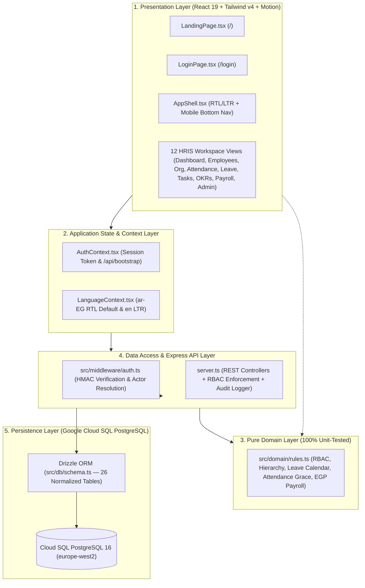
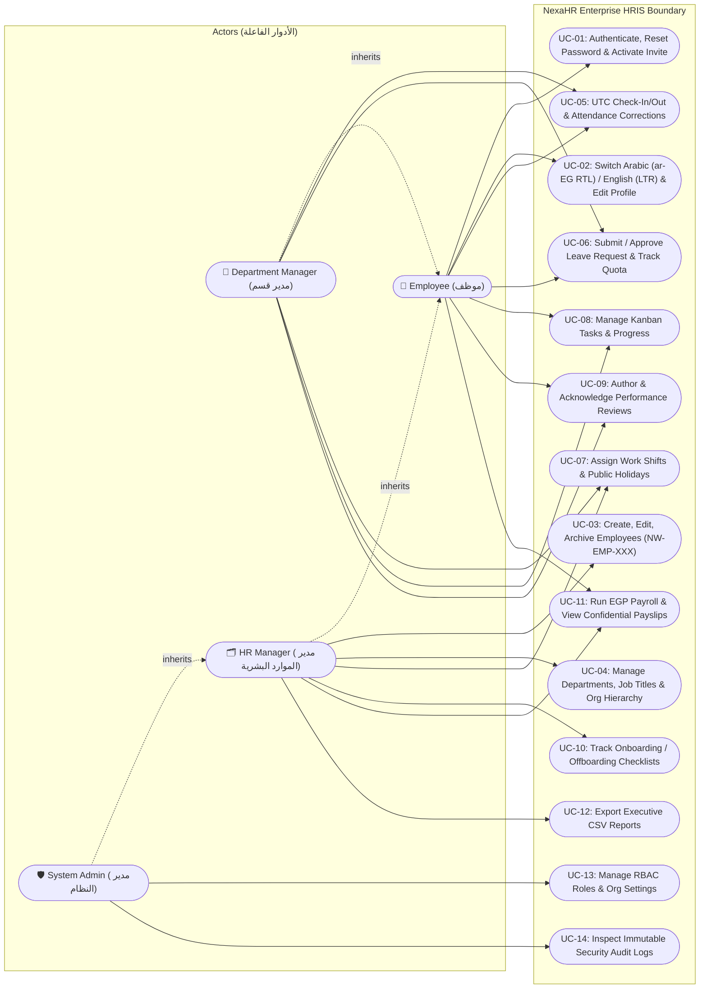
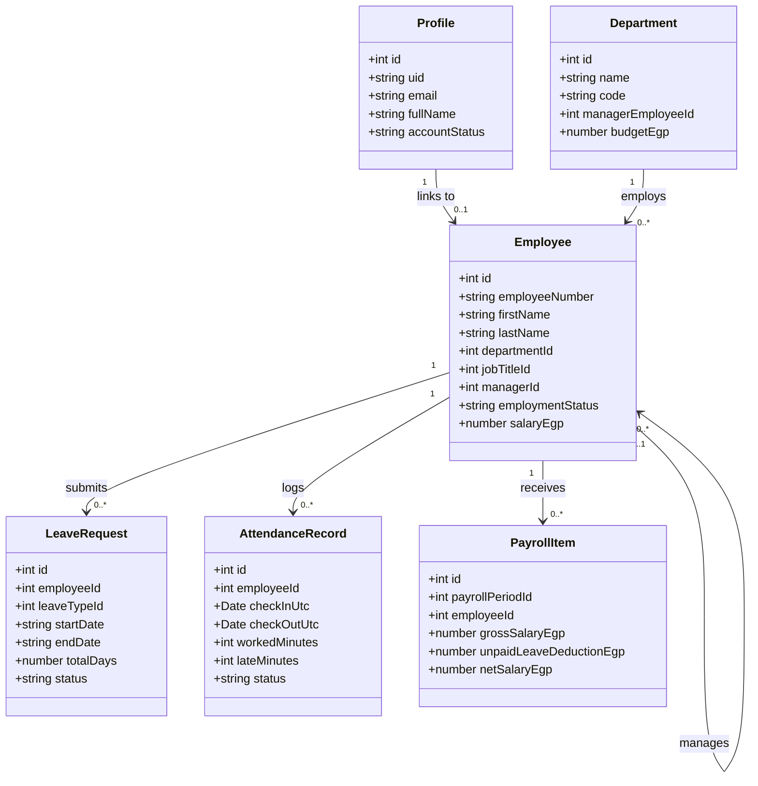
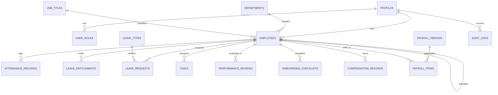
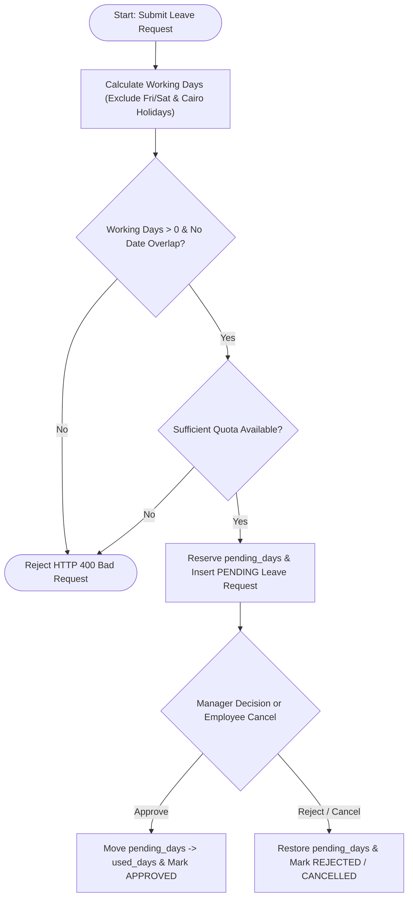
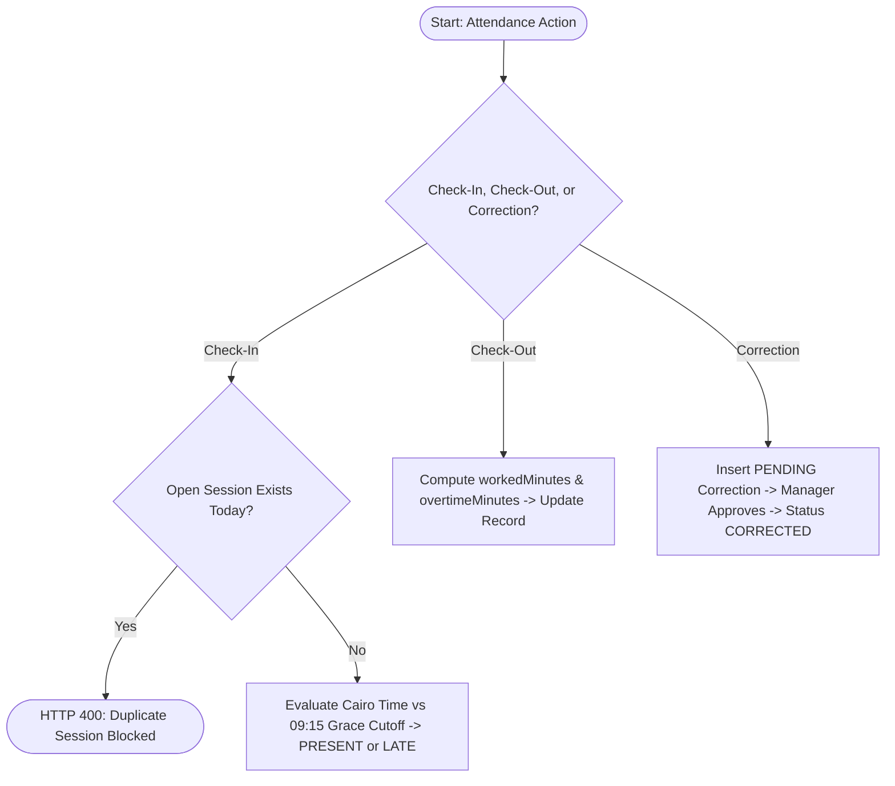
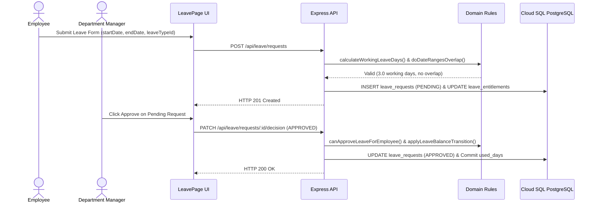

# NexaHR — Formal Project Documentation (15 Slides)
### منصة NexaHR لإدارة الموارد البشرية وشؤون العاملين — التوثيق الهندسي الرسمي (١٥ شريحة)

📥 **[اضغط هنا لتحميل ملف الـ Word الجاهز شاملة كل رسومات الـ UML (NexaHR_Formal_Project_Documentation.docx)](https://ais-dev-hgpszvigiqplubflo5id3o-454931480814.europe-west3.run.app/api/docs/formal-docx)**

---

## Slide 01 / 15 — Executive Project Overview & Baseline Specifications
**NexaHR — Enterprise Employee Management System (`منصة NexaHR للموارد البشرية`)**
- **Tagline**: *"People, Performance, Possibilities."* | *«الكوادر، الأداء، وآفاق المستقبل.»*
- **Executive Summary**: **NexaHR** is a full-stack, production-grade Human Resource Information System (HRIS) engineered for **NexaWorks Technologies SAE** (New Cairo, Egypt). It unifies employee lifecycle records, Egyptian labor calendar leave rules, shift grace-period attendance, Kanban task execution, weighted OKR performance reviews, and confidential `EGP` payroll governance.
- **Bilingual RTL/LTR & Mobile-First UX**: Opens in **Egyptian Arabic (`ar-EG` RTL)** by default with instant switching to **English (`LTR`)**, preserving the English **`NexaHR`** brand identity and responsive mobile layouts (`375px–1440px`) with a quick-navigation bottom bar.
- **Relational Persistence & Pure Domain Engine**: Backed by **26 normalized PostgreSQL tables** on Google Cloud SQL (`europe-west2`) managed via Drizzle ORM, paired with a decoupled, 100% unit-tested domain rule engine in `src/domain/rules.ts`.

| Specification Dimension | Implemented Production Configuration |
| :--- | :--- |
| **Platform Brand & Tagline** | **NexaHR** — *"People, Performance, Possibilities."* |
| **Default Organization** | **NexaWorks Technologies SAE** (Headquartered in New Cairo, Cairo Governorate, Egypt) |
| **Regional Baseline** | Timezone: `Africa/Cairo (UTC+2)` · Currency: `EGP` · Weekend: `Friday & Saturday` · Date: `DD/MM/YYYY` |
| **Default Language & Direction** | **Egyptian Arabic (`ar-EG`, `dir="rtl"`)** default + Full **English (`en`, `dir="ltr"`)** support |
| **Frontend & Motion Stack** | React 19, TypeScript, Tailwind CSS v4, Motion (`motion/react`), Recharts, Lucide Icons |
| **Backend & Database Stack** | Node.js, Express REST API, Drizzle ORM, Google Cloud SQL for PostgreSQL (26 Tables) |
| **Seeded Enterprise Dataset** | 25 Active/Onboarding/Archived Employees, 5 Departments, 14 Job Titles, 4 Role Personas |

---

## Slide 02 / 15 — 5-Layer Clean Architecture & Component Model
**المعمارية الهندسية خماسية الطبقات**

| Architecture Layer | Source Files | Core Engineering Responsibility |
| :--- | :--- | :--- |
| **1. Presentation Layer** | `src/features/*`, `AppShell.tsx` | Responsive RTL/LTR UI, Landing Page simulator, 12 workspace views, mobile bottom nav & drawer |
| **2. Application Layer** | `AuthContext.tsx`, `LanguageContext.tsx` | Session token lifecycle, `/api/bootstrap` synchronization, role switching, `ar-EG`/`en` localization |
| **3. Domain Layer** | `src/domain/rules.ts`, `rules.test.ts` | Pure business logic: RBAC matrix, circular manager check, working days, attendance & `EGP` payroll |
| **4. Data Access & API** | `server.ts`, `src/middleware/auth.ts` | Express REST routes, HMAC token verification, server-side RBAC guards, audit trail & notifications |
| **5. Persistence Layer** | `src/db/schema.ts`, `src/db/seed.ts` | 26 normalized PostgreSQL tables with FK constraints and idempotent 25-employee Cairo seed |

---

## Slide 03 / 15 — Implemented Functional Modules Catalog (16 Modules)
**وحدات النظام الوظيفية المتكاملة**

| Module ID & Name | Route / Scope | Key Implemented Capabilities & Domain Validations |
| :--- | :--- | :--- |
| **M00: Interactive Landing Page** | `/` | Smooth motion hero, live Attendance/Payroll/Leave preview, EGP Payroll Simulator, Demo Booking Modal |
| **M01: Auth & Activation** | `/login` | Email/password sign-in, password reset, invite token activation (`INV-XXXXXX`), 1-click role cards |
| **M02: Role-Scoped Dashboard** | `/dashboard` | Tailored KPIs for Admin, HR, Dept Manager, and Employee; live UTC check-in/out & workforce charts |
| **M03: Employee Directory** | `/employees` | 360° profiles, search/filter, CSV export, auto `NW-EMP-XXX` code, circular hierarchy guard, archive |
| **M04: Organization & Hierarchy** | `/organization` | Department CRUD, active-staff archive guard, EGP salary bands, interactive collapsible Org Chart |
| **M05: Attendance & Punctuality** | `/attendance` | Server UTC check-in/out, duplicate session guard, Cairo `09:00 + 15m` grace calculation, corrections |
| **M06: Leave & Entitlements** | `/leave` | Excludes `Fri/Sat` & Cairo holidays, date-overlap guard, pending/used quota transitions, approvals |
| **M07: Shifts & Holidays** | `/scheduling` | Morning (`09:00`), Flex (`10:00`) & Night (`22:00`) shifts, employee shift assignments, holiday calendar |
| **M08: Tasks & Kanban Board** | `/tasks` | 5-column Kanban (`TODO`, `IN_PROGRESS`, `IN_REVIEW`, `COMPLETED`, `BLOCKED`), progress slider & comments |
| **M09: Performance & OKRs** | `/performance` | Weighted competency matrix (`1.0–5.0`), auto rating category, `DRAFT → PUBLISHED → ACKNOWLEDGED` |
| **M10: Onboarding & Offboarding** | `/onboarding` | Automated IT/HR/Finance/Manager clearance tasks with live employee onboarding % recalculation |
| **M11: EGP Payroll & Comp** | `/payroll` | Monthly `EGP` payroll cycles (`PAY-2026-10`), unpaid leave deduction engine, strict RBAC confidentiality |
| **M12–M14: Reports, Notifs, Admin** | `/reports`, `/admin` | Header notification bell, CSV exports, RBAC role assignment with self-demotion lock, audit log viewer |

---

## Slide 04 / 15 — Role-Based Access Control (RBAC) & Security Governance
**مصفوفة الصلاحيات والأمان (RBAC)**

| RBAC Role | Arabic Title | Demo Persona | Email (`NexaHR@2026`) | Authorized Operational Scope |
| :--- | :--- | :--- | :--- | :--- |
| `SYSTEM_ADMIN` | مدير النظام | **Eng. Tarek El-Masry** (CTO) | `admin@nexaworks.eg` | Full org settings, RBAC role management, immutable audit logs, all HR & payroll modules |
| `HR_MANAGER` | مدير الموارد البشرية | **Laila Hassan** (Head of People) | `hr@nexaworks.eg` | Employee CRUD/archive, departments, onboarding, leave overrides, EGP payroll & compensation |
| `DEPARTMENT_MANAGER` | مدير إدارة / قسم | **Eng. Omar Abdelrahman** (VP Eng) | `manager@nexaworks.eg` | Direct reports attendance/leave approvals, team Kanban tasks & OKR reviews (**No team salary access**) |
| `EMPLOYEE` | موظف | **Eng. Nour El-Din** (Sr. Engineer) | `employee@nexaworks.eg` | Self-service check-in/out, leave requests, assigned tasks, review sign-off, personal EGP payslip |

- **Compensation & Payroll Isolation**: Enforced via `canAccessEmployeeCompensation()` in `src/domain/rules.ts` and `server.ts`. Department Managers are strictly blocked at the API layer from viewing other employees’ salaries.
- **Self-Approval & Scope Guards**: `canApproveLeaveForEmployee()` ensures managers can only approve requests for direct reports/managed departments and never self-approve.
- **Admin Self-Demotion Lock**: `PATCH /api/admin/users/:profileId/role` prevents System Administrators from revoking their own `SYSTEM_ADMIN` role.

---

## Slide 05 / 15 — System Actors & UML Use Case Specification
**مخطط حالات الاستخدام (UML Use Case Diagram)**

---

## Slide 06 / 15 — Enterprise Domain Model & UML Class Diagram
**مخطط الفئات والكائنات (UML Class Diagram)**

---

## Slide 07 / 15 — PostgreSQL Relational Schema & Crow’s Foot ER Diagram
**مخطط علاقات قاعدة البيانات (26 Normalized PostgreSQL Tables)**

---

## Slide 08 / 15 — UML Activity Diagram: Leave Request & Approval Workflow
**مخطط النشاط لدورة الإجازات والأرصدة**

- **Working-Day Engine (`calculateWorkingLeaveDays`)**: Automatically excludes Egyptian weekend days (`Friday,Saturday`) and official public holidays (`public_holidays`).
- **Transactional Balance Reservation (`applyLeaveBalanceTransition`)**: Submitting a paid leave request reserves `pending_days`; Manager approval moves `pending_days` to `used_days`; Rejection or cancellation restores `pending_days` to available quota.

---

## Slide 09 / 15 — UML Activity Diagram: Attendance & Punctuality Workflow
**مخطط النشاط للحضور والانصراف وتصحيح البصمة**

- **Grace Window Calculation (`calculateAttendanceMetrics`)**: Compares server UTC check-in against the assigned Cairo shift (`09:00` + `15` min grace window = `09:15`).
- **Correction Workflow**: Employees can submit a timestamp correction request (`PENDING`), which updates `attendance_records` to `CORRECTED` once approved by a Manager or HR.

---

## Slide 10 / 15 — UML Activity Diagram: Employee Creation & Auto-Provisioning
**مخطط النشاط لإضافة موظف والتجهيز التلقائي**

- **Circular Hierarchy Guard (`hasCircularManagerRelationship`)**: Walks the supervisor chain to prevent self-reporting (`empId === managerId`) and multi-hop cycles (`A → B → C → A`).
- **Parallel Provisioning**: Automatically assigns the next sequential `NW-EMP-XXX` code and provisions 2026 leave entitlements, EGP compensation record,onboarding checklist, and audit log entry.

---

## Slide 11 / 15 — UML Sequence Diagram: Leave Submission & Manager Approval
**مخطط التتابع لتقديم واعتماد الإجازات**

---

## Slide 12 / 15 — UML Sequence Diagrams: Provisioning & Auth/RTL Bootstrap
**مخططات التتابع للتعيين والمصادقة وتهيئة اللغة العربية**

1. **Employee Auto-Provisioning (`POST /api/employees`)**: Validates fields and acyclic manager chain, generates `NW-EMP-026`, and inserts into `employees`, `leave_entitlements`, `compensation_records`, `onboarding_checklists`, and `audit_logs`.
2. **Authentication & Arabic RTL Bootstrap (`POST /api/auth/login` + `GET /api/bootstrap`)**: Initializes `ar-EG` (`dir="rtl"`) by default, verifies credentials, issues a signed HMAC token, and returns RBAC-filtered workspace data.

---

## Slide 13 / 15 — EGP Payroll Engine & Leave / Task State Machines
**تتابع مسير المرتبات ومخططات الحالة للإجازات والمهام**

- **Egyptian EGP Payroll Formula (`calculatePayrollItem`)**:
  - $\text{Gross Salary (EGP)} = \text{Base Salary} + \text{Housing} + \text{Transport} + \text{Other Allowances}$
  - $\text{Unpaid Leave Deduction (EGP)} = \text{round}\left(\frac{\text{Base Salary}}{22} \times \text{Unpaid Leave Days}\right)$
  - $\text{Net Salary (EGP)} = \max(0, \text{Gross Salary} + \text{Bonuses} - \text{Standard Deductions} - \text{Unpaid Deduction})$
- **Leave Lifecycle States**: `PENDING → APPROVED | REJECTED | CANCELLED`, `APPROVED → CANCELLED`.
- **Kanban Task States**: `TODO ↔ IN_PROGRESS ↔ IN_REVIEW → COMPLETED` (plus `BLOCKED`).

---

## Slide 14 / 15 — Appraisal State Machines & Cloud Deployment Topology
**مخططات الحالة للأداء والمرتبات ومعمارية النشر السحابي**

- **Performance Review Lifecycle**: `DRAFT (Manager/HR Confidential) → PUBLISHED (Visible to Employee) → ACKNOWLEDGED (Signed off by Employee)`.
- **Payroll Period Lifecycle**: `DRAFT (Simulation) → APPROVED (Locked by HR/Admin) → PAID (Disbursed)`.
- **Deployment Architecture**: Node.js 22 + Express + Vite SPA container on **Google Cloud Run (`Port 3000`, HTTPS)** connected over encrypted TLS to **Google Cloud SQL for PostgreSQL 16 (`europe-west2`)**.

---

## Slide 15 / 15 — Requirements Traceability, Automated Testing & Verification
**مصفوفة التتبع والاختبارات الآلية والتحقق الهندسي**

| Test Case ID | Verified Domain Rule in `src/domain/rules.ts` | Status |
| :--- | :--- | :--- |
| **TEST-01 & 02** | Employee field validation, EGP salary bounds, self-reporting guard & circular manager loop detection | **PASS (`ok`)** |
| **TEST-03** | Sequential employee code generator (`generateNextEmployeeNumber` → `NW-EMP-026`) | **PASS (`ok`)** |
| **TEST-04 & 05** | Working leave days calculator (excludes `Fri/Sat` & Cairo holidays) & overlapping date range detection | **PASS (`ok`)** |
| **TEST-06** | Transactional leave state machine & balance transitions (`SUBMIT`, `APPROVE`, `REJECT`, `CANCEL`) | **PASS (`ok`)** |
| **TEST-07** | Attendance worked/late/overtime calculator with 15-minute grace period & overnight shift support | **PASS (`ok`)** |
| **TEST-08** | Egyptian EGP Payroll formula (`Gross = Base + Allowances`, `Unpaid Leave Deduction`, `Net Pay`) | **PASS (`ok`)** |
| **TEST-09** | Strict 4-role RBAC permission matrix & compensation confidentiality enforcement | **PASS (`ok`)** |
| **TEST-10** | Egyptian Arabic (`ar-EG` RTL) localization & bilingual demo contact request validation | **PASS (`ok`)** |
