# NexaHR — Enterprise-Grade Employee Management System
### منصة NexaHR — نظام إدارة الموارد البشرية وشؤون العاملين للشركات

> **"People, Performance, Possibilities." | «الكوادر، الأداء، وآفاق المستقبل.»**  
> Full-Stack Enterprise Web Application & Software Engineering II Academic Deliverable  
> Default Organization: **NexaWorks Technologies SAE** (`Africa/Cairo` · `EGP` · `DD/MM/YYYY` · Default **Egyptian Arabic `ar-EG` RTL** & **English LTR**)

---

## Table of Contents

1. [Project Overview & Engineering Architecture](#1-project-overview--engineering-architecture)
2. [Implemented Functional Modules (Landing + 14 HRIS Modules + Egyptian Arabic RTL)](#2-implemented-functional-modules-landing--14-hris-modules--egyptian-arabic-rtl)
3. [Role-Based Access Control (RBAC) & Demo Accounts](#3-role-based-access-control-rbac--demo-accounts)
4. [Complete OMG UML 2.5 & Software Engineering Diagrams](#4-complete-omg-uml-25--software-engineering-diagrams)
   - [4.1 UML Use Case Diagram](#41-uml-use-case-diagram)
   - [4.2 UML Activity Diagram — Leave Request & Approval Workflow](#42-uml-activity-diagram--leave-request--approval-workflow)
   - [4.3 UML Activity Diagram — Attendance Check-In, Check-Out & Correction Workflow](#43-uml-activity-diagram--attendance-check-in-check-out--correction-workflow)
   - [4.4 UML Activity Diagram — Employee Creation & Parallel Onboarding (Fork/Join)](#44-uml-activity-diagram--employee-creation--parallel-onboarding-forkjoin)
   - [4.5 UML Sequence Diagram — Leave Submission & Manager Approval](#45-uml-sequence-diagram--leave-submission--manager-approval)
   - [4.6 UML Sequence Diagram — Employee Creation & Auto-Provisioning](#46-uml-sequence-diagram--employee-creation--auto-provisioning)
   - [4.7 UML Sequence Diagram — Default Egyptian Arabic (`ar-EG` RTL), Auth & RBAC Bootstrap](#47-uml-sequence-diagram--default-egyptian-arabic-ar-eg-rtl-auth--rbac-bootstrap)
   - [4.8 UML Sequence Diagram — EGP Payroll Simulation & RBAC Confidentiality](#48-uml-sequence-diagram--egp-payroll-simulation--rbac-confidentiality)
   - [4.9 UML Domain Class Diagram (3-Compartment Specification)](#49-uml-domain-class-diagram-3-compartment-specification)
   - [4.10 Crow's Foot Entity-Relationship (ER) Diagram](#410-crows-foot-entity-relationship-er-diagram)
   - [4.11 UML State Machine Diagrams (Leave, Kanban, Performance & Payroll)](#411-uml-state-machine-diagrams-leave-kanban-performance--payroll)
   - [4.12 UML Component & 5-Layer Architecture Diagram](#412-uml-component--5-layer-architecture-diagram)
   - [4.13 UML Deployment & Cloud Infrastructure Diagram](#413-uml-deployment--cloud-infrastructure-diagram)
5. [Requirements-to-Code & Database Traceability Matrix](#5-requirements-to-code--database-traceability-matrix)
6. [Documentation & UML Source Index (`/docs`)](#6-documentation--uml-source-index-docs)
7. [Running & Testing Locally](#7-running--testing-locally)

---

## 1. Project Overview & Engineering Architecture

**NexaHR** is a full-stack, production-grade Employee Management System (HRIS) modeled after commercial platforms such as BambooHR, Zoho People, OrangeHRM, and Odoo Employees. It is built for **NexaWorks Technologies SAE** (headquartered in New Cairo, Egypt) and operates on a real **Google Cloud SQL for PostgreSQL** relational database (`europe-west2`) with **Drizzle ORM**, **Express**, **Motion**, and **React 19 + TypeScript**.

### 5-Layer Clean Architecture

| Layer | Directory / Files | Responsibility |
| :--- | :--- | :--- |
| **1. Presentation Layer** | `src/features/landing/LandingPage.tsx`, `src/components/layout/AppShell.tsx`, `src/features/*` | Interactive marketing & live-preview Landing Page (`/`), clean Sign-In/Activation portal (`/login`), 12 authenticated HRIS workspace screens, interactive org chart, Kanban board, Recharts analytics, and default **Egyptian Arabic (`ar-EG` RTL)** with instant **English (`LTR`)** switching. |
| **2. Application Layer** | `src/context/AuthContext.tsx`, `src/context/LanguageContext.tsx` | Session state orchestration, authorized workspace bootstrap (`/api/bootstrap`), role switcher, and bilingual translation hooks (`t`, `trDept`, `trTitle`, `trStatus`, `trRole`, `trLeaveType`). |
| **3. Domain Layer** | `src/domain/rules.ts`, `src/domain/rules.test.ts` | Pure, unit-tested business rules: RBAC matrix, circular hierarchy detection, sequential `NW-EMP-XXX` generator, working-day leave calculator (excluding Friday/Saturday & Egyptian holidays), leave state machine, attendance grace-period calculator, `EGP` payroll engine, and demo contact request validator. |
| **4. Data Access & API Layer** | `server.ts`, `src/middleware/auth.ts`, `src/db/index.ts` | Express REST API controllers, HMAC/Bearer token authentication, server-side RBAC enforcement, confidential field filtering, notification dispatching, and immutable audit logging. |
| **5. Persistence Layer** | `src/db/schema.ts`, `src/db/seed.ts` | 26 normalized PostgreSQL tables managed via Drizzle ORM and seeded with the 25-employee **NexaWorks Technologies SAE** dataset. |

---

## 2. Implemented Functional Modules (Landing + 14 HRIS Modules + Egyptian Arabic RTL)

1. **Interactive Enterprise Landing Page (`/`)**: Smooth staggered `motion/react` entrance animations, live interactive system preview tabs (Attendance, EGP Payroll, Leave Engine), live EGP Payroll & Unpaid Leave Simulator wired to `calculatePayrollItem`, validated Contact / Live Company Demo Booking Modal, and 1-click Demo Role Launcher.
2. **Authentication & Account Activation (`/login`)**: Work email + password login, password reset (`/api/auth/reset-password`), invitation token activation (`INV-XXXXXX`), and one-click demo role personas.
3. **Role-Scoped Dashboards (`/dashboard`)**: Distinct KPIs and action queues for `SYSTEM_ADMIN`, `HR_MANAGER`, `DEPARTMENT_MANAGER`, and `EMPLOYEE`, with live check-in/out controls and workforce charts.
4. **Employee Directory & 360° Profiles (`/employees`, `/employees/:id`)**: Searchable/filterable table and grid views, CSV export, full employee profile view, create/edit modal with circular-reporting validation, auto-generated `NW-EMP-XXX` codes, and non-destructive archival/reactivation.
5. **Organization & Interactive Hierarchy (`/organization`)**: Department CRUD, active-employee archival guard, job title salary bands (`min_salary_egp` – `max_salary_egp`), and an interactive multi-level reporting tree rooted at the CTO (`NW-EMP-001`).
6. **Attendance & Punctuality Tracking (`/attendance`)**: Authoritative UTC check-in/out, duplicate open-session prevention, `Africa/Cairo` (`UTC+2`) shift grace-period late calculation, and attendance correction request/approval workflows.
7. **Leave Management & Entitlement Engine (`/leave`)**: Working-day calculation excluding `Friday,Saturday` weekends and Egyptian official holidays, overlap detection, live balance cards (`Allocated / Used / Pending / Available`), and transactional approval, rejection, and cancellation.
8. **Shift & Schedule Management (`/scheduling`)**: Standard Cairo HQ (`09:00–17:00`), Flexible Engineering (`10:00–18:00`), and Overnight Support (`22:00–06:00`) shifts, employee shift assignments, and official public holiday calendar.
9. **Task & Kanban Management (`/tasks`)**: 5-column Kanban board (`TODO`, `IN_PROGRESS`, `IN_REVIEW`, `COMPLETED`, `BLOCKED`), task assignment, progress sliders, and activity comments.
10. **Performance & OKR Management (`/performance`)**: Weighted competency evaluation matrix (`1.0`–`5.0`), automatic rating classification (*Outstanding*, *Exceeds Expectations*, *Meets Expectations*), confidential `DRAFT` reviews, HR `PUBLISHED` state, and employee `ACKNOWLEDGED` sign-off.
11. **Onboarding & Offboarding Workflows (`/onboarding`)**: Automated clearance checklists across IT, HR Documentation, Finance, and Department Managers with automatic employee onboarding percentage updates.
12. **Compensation & Payroll Simulation (`/payroll`)**: Monthly `EGP` payroll register (`PAY-2026-09`, `PAY-2026-10`), interactive Egyptian payroll formula simulator, `DRAFT → APPROVED → PAID` governance, and strict RBAC confidentiality.
13. **Persistent Notifications (`Header Bell`)**: Real-time unread counter and notification drawer backed by the `notifications` PostgreSQL table.
14. **Executive Reports & CSV Exports (`/reports`)**: Departmental budget analytics and one-click CSV exports for Master Employee Roster, Attendance Logs, and Leave Utilization.
15. **System Administration & Security Audit (`/admin`)**: User role management (with self-demotion safety lock), account status control, and an immutable `audit_logs` inspector.
16. **Default Egyptian Arabic (`ar-EG`) RTL Localization**: Opens in Egyptian Arabic (`dir="rtl" lang="ar-EG"`) by default with **Cairo** & **IBM Plex Sans Arabic** typography, natural Egyptian business phrasing, and consistent English **`NexaHR`** brand identity across all screens.

---

## 3. Role-Based Access Control (RBAC) & Demo Accounts

| Role | Arabic Title | Demo Persona | Email | Password | Key Permissions |
| :--- | :--- | :--- | :--- | :--- | :--- |
| `SYSTEM_ADMIN` | مدير النظام | **Tarek El-Masry** (CTO) | `admin@nexaworks.eg` | `NexaHR@2026` | Full org settings, RBAC role assignments, audit logs, all HR & payroll operations. |
| `HR_MANAGER` | مدير الموارد البشرية | **Laila Hassan** (Head of People) | `hr@nexaworks.eg` | `NexaHR@2026` | Employee CRUD/archive, departments, onboarding, leave overrides, payroll & compensation. (No system role admin). |
| `DEPARTMENT_MANAGER` | مدير إدارة / قسم | **Omar Abdelrahman** (VP Engineering) | `manager@nexaworks.eg` | `NexaHR@2026` | View direct reports, approve/reject team leave & attendance corrections, assign team tasks & reviews. (**Blocked** from other employees' compensation/payroll). |
| `EMPLOYEE` | موظف | **Nour El-Din** (Senior Engineer) | `employee@nexaworks.eg` | `NexaHR@2026` | Self-service profile contact edit, check-in/out, submit/cancel own leave, update assigned tasks, acknowledge published reviews, view own payslip. |

---

## 4. Complete OMG UML 2.5 & Software Engineering Diagrams

All 13 diagrams below are rendered as **self-contained, standards-compliant OMG UML 2.5 vector `.svg` assets** (`docs/uml/svg/*.svg`) generated directly from the NexaHR domain and database architecture (`server.ts`, `src/domain/rules.ts`, `src/db/schema.ts`, and `src/features/*`). Embedding pre-rendered pure SVG vector files guarantees instant, zero-error rendering across GitHub web, mobile, and PDF exports without `viewscreen` iframe timeouts.

---

### 4.1 UML Use Case Diagram

Models the four-actor generalization hierarchy (`Employee` inherited by `Department Manager`, `HR Manager`, and `System Administrator`), the `«system» NexaHR` boundary, the 14 core use cases (`UC-01` through `UC-14`), and shared `«include»` domain/security subroutines.

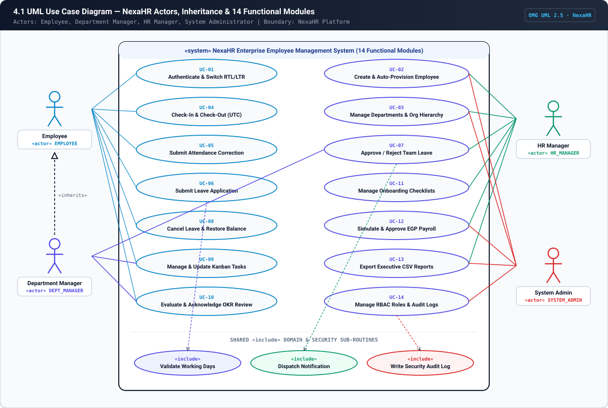

- **Vector SVG Asset:** [`docs/uml/svg/01-use-case.svg`](docs/uml/svg/01-use-case.svg)
- **PlantUML Source:** [`docs/uml/use-case.puml`](docs/uml/use-case.puml)

---

### 4.2 UML Activity Diagram — Leave Request & Approval Workflow

Models the 3-swimlane activity flow (`Employee`, `NexaHR Backend & Domain Engine`, `Department Manager / HR Manager`) across `POST /api/leave/requests` and `PATCH /api/leave/requests/:id/decision`, including Friday/Saturday & Cairo official holiday exclusion, overlap detection, `pending_days` reservation, and transactional quota movement.

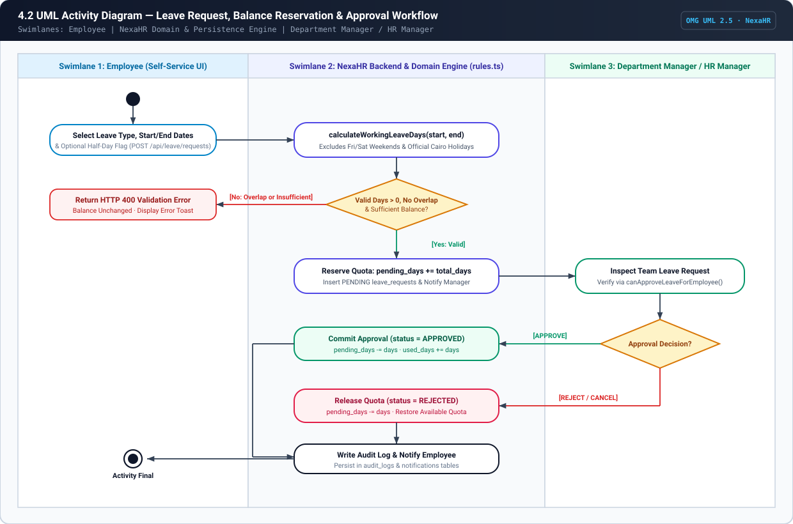

- **Vector SVG Asset:** [`docs/uml/svg/02-activity-leave.svg`](docs/uml/svg/02-activity-leave.svg)
- **PlantUML Source:** [`docs/uml/leave-activity.puml`](docs/uml/leave-activity.puml)

---

### 4.3 UML Activity Diagram — Attendance Check-In, Check-Out & Correction Workflow

Models the server-authoritative UTC attendance workflow in `POST /api/attendance/check-in`, `POST /api/attendance/check-out`, and `PATCH /api/attendance/corrections/:id`, including duplicate open-session guards, `09:00` Cairo shift grace-period (`15m`) punctuality calculation, and manager correction overrides.

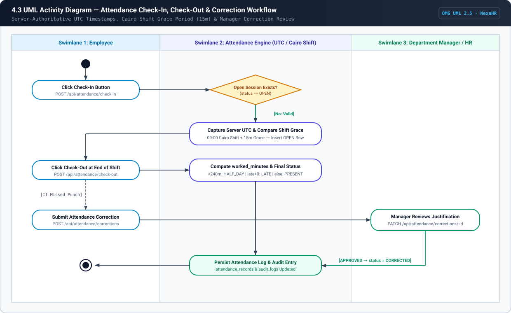

- **Vector SVG Asset:** [`docs/uml/svg/03-activity-attendance.svg`](docs/uml/svg/03-activity-attendance.svg)
- **PlantUML Source:** [`docs/uml/attendance-activity.puml`](docs/uml/attendance-activity.puml)

---

### 4.4 UML Activity Diagram — Employee Creation & Parallel Onboarding (Fork/Join)

Models the RBAC check (`MANAGE_EMPLOYEES`), `validateEmployeeInput`, circular reporting hierarchy guard (`hasCircularManagerRelationship`), sequential `NW-EMP-026` code generation, and the **UML Fork/Join (`«fork»` / `«join»`)** concurrency bar that provisions 2026 Leave Entitlements, EGP Compensation, Onboarding Checklists, and Security Audit Logs.

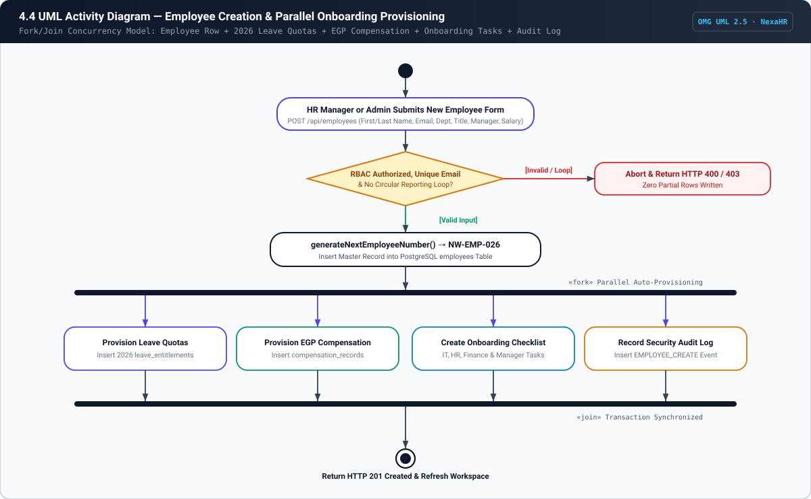

- **Vector SVG Asset:** [`docs/uml/svg/04-activity-onboarding.svg`](docs/uml/svg/04-activity-onboarding.svg)

---

### 4.5 UML Sequence Diagram — Leave Submission & Manager Approval

Traces synchronous method invocations, lifeline activation bars, and `alt` combined fragments across `:Employee`, `:DeptManager`, `:LeavePageUI`, `:LeaveController`, `:DomainRules`, and `:PostgreSQL`.

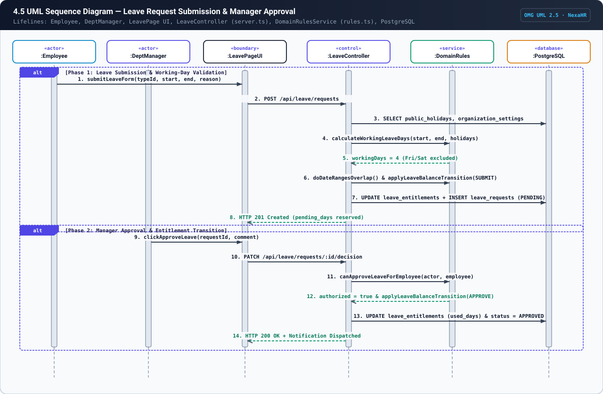

- **Vector SVG Asset:** [`docs/uml/svg/05-sequence-leave.svg`](docs/uml/svg/05-sequence-leave.svg)
- **PlantUML Source:** [`docs/uml/leave-sequence.puml`](docs/uml/leave-sequence.puml)

---

### 4.6 UML Sequence Diagram — Employee Creation & Auto-Provisioning

Traces `POST /api/employees` from `:HRManager` through `:EmployeesPageUI`, `:EmployeeController`, `:DomainRules`, and `:PostgreSQL` with `opt [canPerformAction(MANAGE_EMPLOYEES) == true]`.

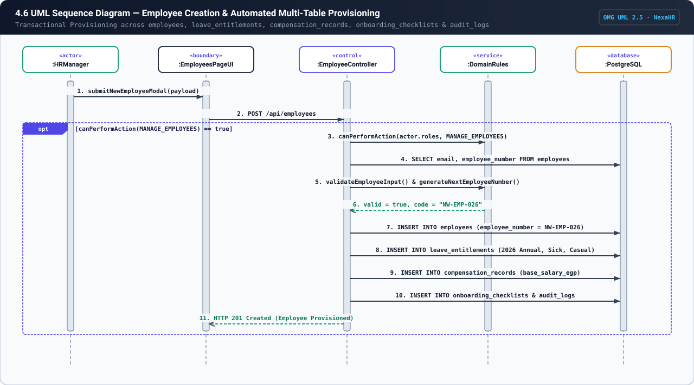

- **Vector SVG Asset:** [`docs/uml/svg/06-sequence-employee.svg`](docs/uml/svg/06-sequence-employee.svg)
- **PlantUML Source:** [`docs/uml/employee-sequence.puml`](docs/uml/employee-sequence.puml)

---

### 4.7 UML Sequence Diagram — Default Egyptian Arabic (`ar-EG` RTL), Auth & RBAC Bootstrap

Illustrates how `resolveInitialLocale()` sets Egyptian Arabic (`dir="rtl" lang="ar-EG"`) by default on mount, followed by credential authentication (`POST /api/auth/login`) and role-scoped workspace hydration (`GET /api/bootstrap`).

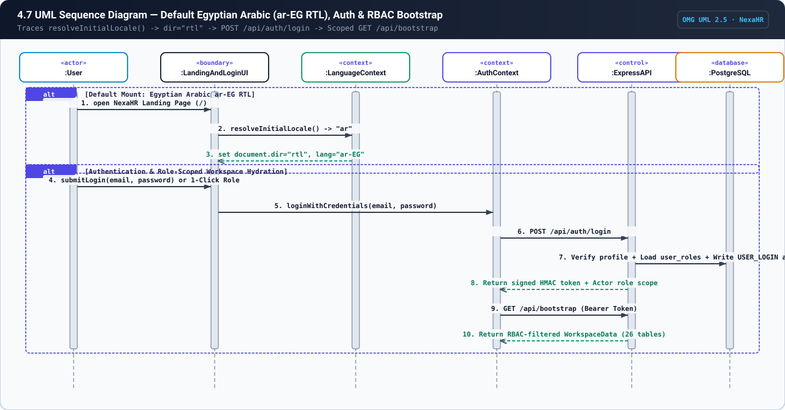

- **Vector SVG Asset:** [`docs/uml/svg/07-sequence-auth-rtl.svg`](docs/uml/svg/07-sequence-auth-rtl.svg)

---

### 4.8 UML Sequence Diagram — EGP Payroll Simulation & RBAC Confidentiality

Demonstrates negative RBAC enforcement (`Case A`: Department Managers are restricted strictly to their own payslip row in `/api/bootstrap`) alongside HR Manager EGP payroll simulation (`calculatePayrollItem`) and cycle approval (`Case B`).

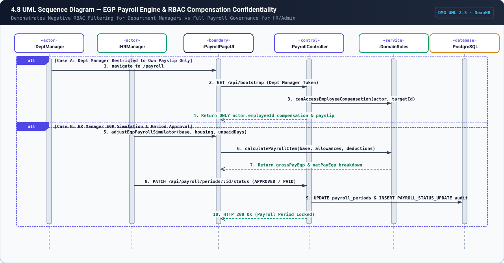

- **Vector SVG Asset:** [`docs/uml/svg/08-sequence-payroll.svg`](docs/uml/svg/08-sequence-payroll.svg)

---

### 4.9 UML Domain Class Diagram (3-Compartment Specification)

Models the core domain entities, stereotypes (`«entity»`, `«aggregateRoot»`, `«domainService»`), typed attributes (`PK`, `FK`, `UQ`), operations, composition/aggregation diamonds, and explicit multiplicities (`1`, `0..1`, `1..*`, `0..*`).

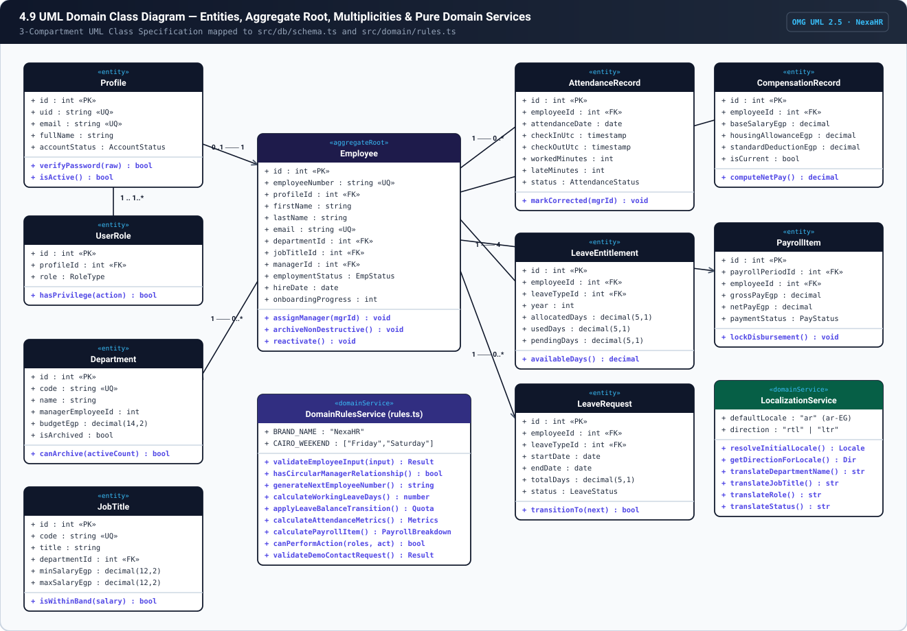

- **Vector SVG Asset:** [`docs/uml/svg/09-class-diagram.svg`](docs/uml/svg/09-class-diagram.svg)
- **PlantUML Source:** [`docs/uml/class-diagram.puml`](docs/uml/class-diagram.puml)

---

### 4.10 Crow's Foot Entity-Relationship (ER) Diagram

Models the normalized PostgreSQL relational schema defined in `src/db/schema.ts`, with primary keys (`PK`), foreign keys (`FK`), unique constraints (`UQ`), PostgreSQL data types, and relational links centered around the `employees` hub table.

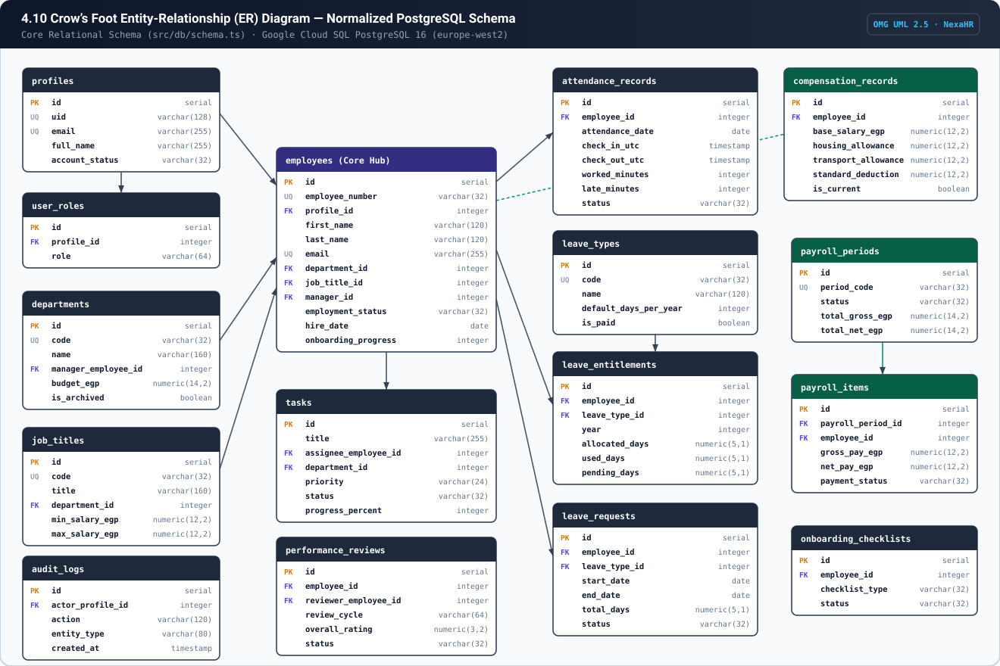

- **Vector SVG Asset:** [`docs/uml/svg/10-er-diagram.svg`](docs/uml/svg/10-er-diagram.svg)
- **Mermaid Source:** [`docs/uml/entity-relationship.mmd`](docs/uml/entity-relationship.mmd)

---

### 4.11 UML State Machine Diagrams (Leave, Kanban, Performance & Payroll)

Models all four stateful domain lifecycles enforced by `src/domain/rules.ts` and `server.ts`:
- **A. Leave Request & Entitlement Balance State Machine** (`PENDING → APPROVED / REJECTED / CANCELLED`)
- **B. Kanban Task Execution State Machine** (`TODO ↔ IN_PROGRESS ↔ BLOCKED / IN_REVIEW → COMPLETED`)
- **C. Performance Review Appraisal State Machine** (`DRAFT → PUBLISHED → ACKNOWLEDGED`)
- **D. EGP Payroll Cycle Governance State Machine** (`DRAFT → APPROVED → PAID`)

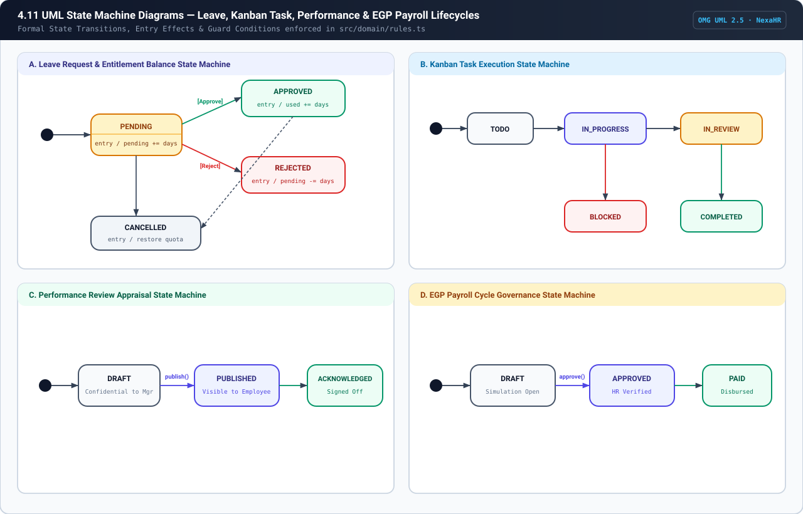

- **Vector SVG Asset:** [`docs/uml/svg/11-state-machines.svg`](docs/uml/svg/11-state-machines.svg)
- **PlantUML Source:** [`docs/uml/leave-state-machine.puml`](docs/uml/leave-state-machine.puml)

---

### 4.12 UML Component & 5-Layer Architecture Diagram

Models the unidirectional dependency flow across the 5 engineering layers (`Presentation Layer` → `Application Context Layer` → `Express API & RBAC Middleware Layer` → `Pure Domain Engine Layer` → `Drizzle ORM & Cloud SQL Persistence Layer`).

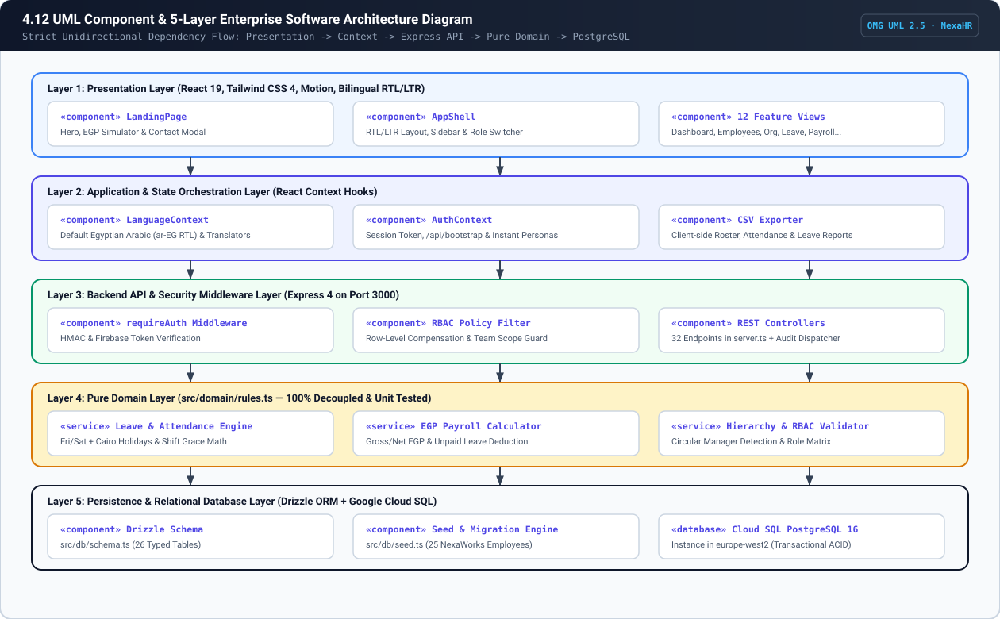

- **Vector SVG Asset:** [`docs/uml/svg/12-component-architecture.svg`](docs/uml/svg/12-component-architecture.svg)
- **Mermaid Source:** [`docs/uml/component-architecture.mmd`](docs/uml/component-architecture.mmd)

---

### 4.13 UML Deployment & Cloud Infrastructure Diagram

Models the runtime deployment topology across `«device» Client Browser (Desktop / Mobile)`, `«executionEnvironment» Google Cloud Run (Node.js 22 / Express 4)`, and `«databaseServer» Google Cloud SQL PostgreSQL 16 (europe-west2)`.

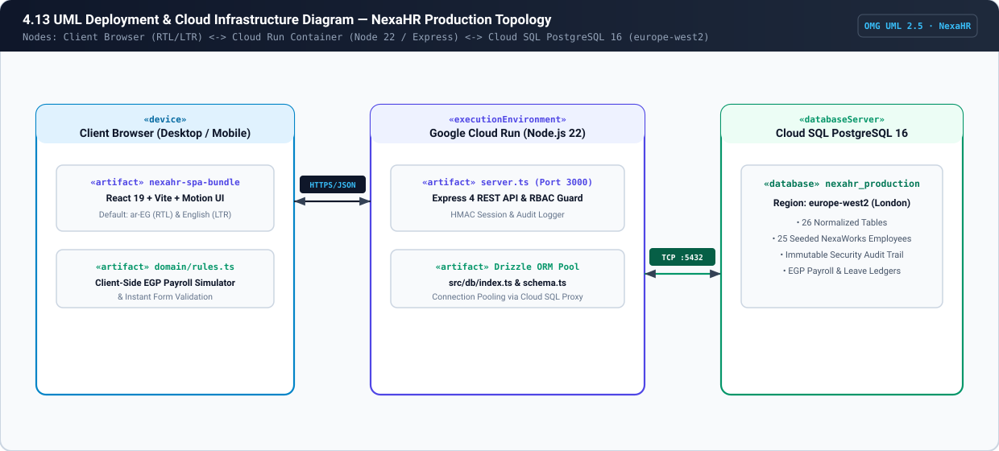

- **Vector SVG Asset:** [`docs/uml/svg/13-deployment-diagram.svg`](docs/uml/svg/13-deployment-diagram.svg)

---

## 5. Requirements-to-Code & Database Traceability Matrix

| Req ID | Requirement Summary | Frontend Component | Backend Endpoint (`server.ts`) | Domain Rule (`src/domain/rules.ts`) | PostgreSQL Tables (`src/db/schema.ts`) |
| :--- | :--- | :--- | :--- | :--- | :--- |
| **FR-001** | Interactive Landing Page, Authentication & Invite Activation | `LandingPage.tsx`, `LoginPage.tsx` | `POST /api/auth/login`, `/reset-password`, `/accept-invite` | `canPerformAction`, `validateDemoContactRequest` | `profiles`, `user_roles`, `audit_logs` |
| **FR-002** | 4-Role RBAC & Server-Side Scope Filtering | `AppShell.tsx`, `AuthContext.tsx` | `GET /api/bootstrap` | `canPerformAction`, `canAccessEmployeeCompensation` | `user_roles`, `profiles`, `employees` |
| **FR-003** | Employee CRUD, Auto `NW-EMP-XXX` & Archival | `EmployeesPage.tsx` | `POST /api/employees`, `PUT /api/employees/:id`, `PATCH /:id/archive` | `validateEmployeeInput`, `generateNextEmployeeNumber`, `hasCircularManagerRelationship` | `employees`, `employee_documents` |
| **FR-004** | Department CRUD, Archival Guard & Org Chart | `OrganizationPage.tsx` | `POST /api/departments`, `PUT /api/departments/:id`, `POST /api/job-titles` | `canPerformAction('MANAGE_DEPARTMENTS')` | `departments`, `job_titles` |
| **FR-005** | UTC Check-In/Out, Duplicate Guard & Corrections | `AttendancePage.tsx` | `POST /api/attendance/check-in`, `/check-out`, `/corrections` | `calculateAttendanceMetrics` | `attendance_records`, `attendance_correction_requests` |
| **FR-006** | Leave Working-Day Calculator & Overlap Guard | `LeavePage.tsx` | `POST /api/leave/requests`, `PATCH /api/leave/requests/:id/decision` | `calculateWorkingLeaveDays`, `doDateRangesOverlap`, `canTransitionLeaveStatus`, `applyLeaveBalanceTransition` | `leave_types`, `leave_entitlements`, `leave_requests`, `public_holidays` |
| **FR-007** | Shift Definitions & Employee Roster Assignment | `SchedulingPage.tsx` | `POST /api/shifts`, `POST /api/shifts/assign` | `calculateAttendanceMetrics` | `work_shifts`, `shift_assignments`, `public_holidays` |
| **FR-008** | Kanban Task Board, Progress & Comments | `TasksPage.tsx` | `POST /api/tasks`, `PATCH /api/tasks/:id`, `POST /api/tasks/:id/comments` | `canPerformAction('MANAGE_TEAM_TASKS')` | `tasks`, `task_comments` |
| **FR-009** | Weighted Performance Appraisal & OKR Goals | `PerformancePage.tsx` | `POST /api/performance/goals`, `PATCH /api/performance/reviews/:id` | `canPerformAction('MANAGE_PERFORMANCE_REVIEWS')` | `performance_goals`, `performance_reviews` |
| **FR-010** | Automated Onboarding & Offboarding Checklists | `OnboardingPage.tsx` | `POST /api/onboarding/checklists`, `PATCH /api/onboarding/tasks/:id/toggle` | `canPerformAction('MANAGE_ONBOARDING')` | `onboarding_checklists`, `onboarding_tasks` |
| **FR-011** | EGP Payroll Engine & Compensation Privacy | `PayrollPage.tsx` | `POST /api/payroll/compensation`, `PATCH /api/payroll/periods/:id/status` | `calculatePayrollItem`, `canAccessEmployeeCompensation` | `compensation_records`, `payroll_periods`, `payroll_items` |
| **FR-012** | Executive Analytics & CSV Data Exports | `ReportsPage.tsx`, `DashboardPage.tsx` | `GET /api/bootstrap` | `formatDateDDMMYYYY` | All operational tables |
| **FR-013** | Immutable Security Audit Logs & Role Admin | `AdminPage.tsx` | `PATCH /api/admin/users/:profileId/role`, `PUT /api/admin/settings` | `canPerformAction('MANAGE_USERS_AND_ROLES')` | `audit_logs`, `organization_settings`, `user_roles` |
| **FR-014** | Default Egyptian Arabic (`ar-EG`) RTL Localization | `LanguageContext.tsx`, All 13 Screens | Bilingual client-side + domain translation layer | `resolveInitialLocale`, `getDirectionForLocale`, `translateDepartmentName`, `translateJobTitle`, `translateStatus`, `translateRole`, `translateLeaveType` | Preserves canonical English/ISO database storage while rendering full Arabic RTL UI |

---

## 6. Documentation & UML Source Index (`/docs`)

In addition to this `README.md`, detailed Software Engineering II deliverables are organized in `/docs`:

- **Requirements & Use Cases:**
  - [`docs/requirements/SRS.md`](docs/requirements/SRS.md) — Software Requirements Specification (`FR` & `NFR` catalog)
  - [`docs/requirements/USE_CASES.md`](docs/requirements/USE_CASES.md) — 12 Structured Use Case Specifications (Preconditions, Postconditions, Main & Exception Flows)
  - [`docs/requirements/TRACEABILITY_MATRIX.md`](docs/requirements/TRACEABILITY_MATRIX.md) — Full Traceability Matrix
- **Architecture, Schema & Verification:**
  - [`docs/architecture/ARCHITECTURE.md`](docs/architecture/ARCHITECTURE.md) — 5-Layer Architecture & RBAC Security Model
  - [`docs/database/SCHEMA.md`](docs/database/SCHEMA.md) — 26-Table Normalized PostgreSQL Schema Documentation
  - [`docs/TEST_PLAN.md`](docs/TEST_PLAN.md) — Automated Unit Test & Negative RBAC Verification Plan
- **Pre-Rendered OMG UML 2.5 Vector SVG Diagrams (`docs/uml/svg/`):**
  - [`docs/uml/svg/01-use-case.svg`](docs/uml/svg/01-use-case.svg)
  - [`docs/uml/svg/02-activity-leave.svg`](docs/uml/svg/02-activity-leave.svg)
  - [`docs/uml/svg/03-activity-attendance.svg`](docs/uml/svg/03-activity-attendance.svg)
  - [`docs/uml/svg/04-activity-onboarding.svg`](docs/uml/svg/04-activity-onboarding.svg)
  - [`docs/uml/svg/05-sequence-leave.svg`](docs/uml/svg/05-sequence-leave.svg)
  - [`docs/uml/svg/06-sequence-employee.svg`](docs/uml/svg/06-sequence-employee.svg)
  - [`docs/uml/svg/07-sequence-auth-rtl.svg`](docs/uml/svg/07-sequence-auth-rtl.svg)
  - [`docs/uml/svg/08-sequence-payroll.svg`](docs/uml/svg/08-sequence-payroll.svg)
  - [`docs/uml/svg/09-class-diagram.svg`](docs/uml/svg/09-class-diagram.svg)
  - [`docs/uml/svg/10-er-diagram.svg`](docs/uml/svg/10-er-diagram.svg)
  - [`docs/uml/svg/11-state-machines.svg`](docs/uml/svg/11-state-machines.svg)
  - [`docs/uml/svg/12-component-architecture.svg`](docs/uml/svg/12-component-architecture.svg)
  - [`docs/uml/svg/13-deployment-diagram.svg`](docs/uml/svg/13-deployment-diagram.svg)
- **Standalone PlantUML & Mermaid Source Files (`docs/uml/`):**
  - [`docs/uml/use-case.puml`](docs/uml/use-case.puml)
  - [`docs/uml/leave-activity.puml`](docs/uml/leave-activity.puml)
  - [`docs/uml/attendance-activity.puml`](docs/uml/attendance-activity.puml)
  - [`docs/uml/leave-sequence.puml`](docs/uml/leave-sequence.puml)
  - [`docs/uml/employee-sequence.puml`](docs/uml/employee-sequence.puml)
  - [`docs/uml/class-diagram.puml`](docs/uml/class-diagram.puml)
  - [`docs/uml/leave-state-machine.puml`](docs/uml/leave-state-machine.puml)
  - [`docs/uml/entity-relationship.mmd`](docs/uml/entity-relationship.mmd)
  - [`docs/uml/component-architecture.mmd`](docs/uml/component-architecture.mmd)

---

## 7. Running & Testing Locally

```bash
# 1. Install dependencies
npm install

# 2. Run pure domain unit tests (RBAC, Leave State Machine, Payroll, Contact Validator & Arabic RTL)
npx --yes tsx --test src/domain/rules.test.ts

# 3. Regenerate all 13 OMG UML 2.5 vector SVG diagrams in docs/uml/svg/
node scripts/generate-uml-svgs.mjs

# 4. Type-check and build production bundle
npm run lint
npm run build

# 5. Start full-stack Express + Vite server on http://localhost:3000
npm run dev
```
