# NexaHR — Enterprise-Grade Employee Management System
### نكسا إتش آر — نظام إدارة الموارد البشرية وشؤون العاملين للشركات

> **"People, Performance, Possibilities." | «الكوادر، الأداء، وآفاق المستقبل.»**  
> Full-Stack Enterprise Web Application & Software Engineering II Academic Deliverable  
> Default Organization: **NexaWorks Technologies SAE** (`Africa/Cairo` · `EGP` · `DD/MM/YYYY` · Bilingual **English LTR** & **Egyptian Arabic `ar-EG` RTL**)

---

## Table of Contents

1. [Project Overview & Engineering Architecture](#1-project-overview--engineering-architecture)
2. [Implemented Functional Modules (14 Modules + Bilingual RTL)](#2-implemented-functional-modules-14-modules--bilingual-rtl)
3. [Role-Based Access Control (RBAC) & Demo Accounts](#3-role-based-access-control-rbac--demo-accounts)
4. [Complete UML & Software Engineering Diagrams](#4-complete-uml--software-engineering-diagrams)
   - [4.1 Use Case Diagram](#41-use-case-diagram)
   - [4.2 Activity Diagram — Leave Request & Balance Transition Workflow](#42-activity-diagram--leave-request--balance-transition-workflow)
   - [4.3 Activity Diagram — Attendance Check-In, Check-Out & Correction Workflow](#43-activity-diagram--attendance-check-in-check-out--correction-workflow)
   - [4.4 Activity Diagram — Employee Creation & Automated Onboarding Provisioning](#44-activity-diagram--employee-creation--automated-onboarding-provisioning)
   - [4.5 Sequence Diagram — Leave Application Submission & Manager Approval](#45-sequence-diagram--leave-application-submission--manager-approval)
   - [4.6 Sequence Diagram — Employee Creation & Multi-Table Auto-Provisioning](#46-sequence-diagram--employee-creation--multi-table-auto-provisioning)
   - [4.7 Sequence Diagram — Authentication, RBAC Bootstrap & Arabic RTL Localization](#47-sequence-diagram--authentication-rbac-bootstrap--arabic-rtl-localization)
   - [4.8 Sequence Diagram — Payroll Simulation, Compensation Confidentiality & Disbursement](#48-sequence-diagram--payroll-simulation-compensation-confidentiality--disbursement)
   - [4.9 Domain Class Diagram](#49-domain-class-diagram)
   - [4.10 Entity-Relationship (ER) Diagram](#410-entity-relationship-er-diagram)
   - [4.11 State Machine Diagrams (Leave, Tasks, Performance Reviews & Payroll)](#411-state-machine-diagrams-leave-tasks-performance-reviews--payroll)
   - [4.12 Component & 5-Layer Architecture Diagram](#412-component--5-layer-architecture-diagram)
   - [4.13 Deployment & Infrastructure Diagram](#413-deployment--infrastructure-diagram)
5. [Requirements-to-Code & Database Traceability Matrix](#5-requirements-to-code--database-traceability-matrix)
6. [Documentation Index (`/docs`)](#6-documentation-index-docs)
7. [Running & Testing Locally](#7-running--testing-locally)

---

## 1. Project Overview & Engineering Architecture

**NexaHR** is a full-stack, production-grade Employee Management System (HRIS) modeled after commercial platforms such as BambooHR, Zoho People, OrangeHRM, and Odoo Employees. It is built for **NexaWorks Technologies SAE** (headquartered in New Cairo, Egypt) and operates on a real **Google Cloud SQL for PostgreSQL** relational database (`europe-west2`) with **Firebase Authentication**, **Drizzle ORM**, **Express**, and **React 19 + TypeScript**.

### Architectural Layers

| Layer | Directory / Files | Responsibility |
| :--- | :--- | :--- |
| **1. Presentation Layer** | `src/components/layout/AppShell.tsx`, `src/features/*` | 12 responsive UI screens, interactive org chart, Kanban board, Recharts analytics, and instant **English (LTR) / Egyptian Arabic (`ar-EG` RTL)** layout mirroring. |
| **2. Application Layer** | `src/context/AuthContext.tsx`, `src/context/LanguageContext.tsx` | Session state orchestration, authorized workspace bootstrap (`/api/bootstrap`), role switcher, and bilingual translation hooks (`t`, `trDept`, `trTitle`, `trStatus`, `trRole`, `trLeaveType`). |
| **3. Domain Layer** | `src/domain/rules.ts`, `src/domain/rules.test.ts` | Pure, unit-tested business rules: RBAC matrix, circular hierarchy detection, sequential `NW-EMP-XXX` generator, working-day leave calculator (excluding Friday/Saturday & Egyptian holidays), leave state machine, attendance grace-period calculator, and `EGP` payroll engine. |
| **4. Data Access & API Layer** | `server.ts`, `src/middleware/auth.ts`, `src/db/index.ts` | Express REST API controllers, HMAC/Firebase bearer token authentication, server-side RBAC enforcement, confidential field filtering, notification dispatching, and immutable audit logging. |
| **5. Persistence Layer** | `src/db/schema.ts`, `src/db/seed.ts` | 26 normalized PostgreSQL tables managed via Drizzle ORM and seeded with the 25-employee **NexaWorks Technologies SAE** dataset. |

---

## 2. Implemented Functional Modules (14 Modules + Bilingual RTL)

1. **Authentication & Account Activation (`/login`):** Work email + password login, Google Workspace OAuth popup sign-in, password reset (`/api/auth/reset-password`), invitation token activation (`INV-XXXXXX`), and one-click demo role personas.
2. **Role-Scoped Dashboards (`/dashboard`):** Distinct KPIs and action queues for `SYSTEM_ADMIN`, `HR_MANAGER`, `DEPARTMENT_MANAGER`, and `EMPLOYEE`, with live check-in/out controls and workforce charts.
3. **Employee Directory & 360° Profiles (`/employees`, `/employees/:id`):** Searchable/filterable table and grid views, CSV export, full employee profile view, create/edit modal with circular-reporting validation, auto-generated `NW-EMP-XXX` codes, and non-destructive archival/reactivation.
4. **Organization & Interactive Hierarchy (`/organization`):** Department CRUD, active-employee archival guard, job title salary bands (`min_salary_egp` – `max_salary_egp`), and an interactive multi-level reporting tree rooted at the CTO (`NW-EMP-001`).
5. **Attendance & Punctuality Tracking (`/attendance`):** Authoritative UTC check-in/out, duplicate open-session prevention, `Africa/Cairo` (`UTC+2`) shift grace-period late calculation, and attendance correction request/approval workflows.
6. **Leave Management & Entitlement Engine (`/leave`):** Working-day calculation excluding `Friday,Saturday` weekends and Egyptian official holidays, overlap detection, live balance cards (`Allocated / Used / Pending / Available`), and transactional approval, rejection, and cancellation.
7. **Shift & Schedule Management (`/scheduling`):** Standard Cairo HQ (`09:00–17:00`), Flexible Engineering (`10:00–18:00`), and Overnight Support (`22:00–06:00`) shifts, employee shift assignments, and official public holiday calendar.
8. **Task & Kanban Management (`/tasks`):** 5-column Kanban board (`TODO`, `IN_PROGRESS`, `IN_REVIEW`, `COMPLETED`, `BLOCKED`), task assignment, progress sliders, and activity comments.
9. **Performance & OKR Management (`/performance`):** Weighted competency evaluation matrix (`1.0`–`5.0`), automatic rating classification (*Outstanding*, *Exceeds Expectations*, *Meets Expectations*), confidential `DRAFT` reviews, HR `PUBLISHED` state, and employee `ACKNOWLEDGED` sign-off.
10. **Onboarding & Offboarding Workflows (`/onboarding`):** Automated clearance checklists across IT, HR Documentation, Finance, and Department Managers with automatic employee onboarding percentage updates.
11. **Compensation & Payroll Simulation (`/payroll`):** Monthly `EGP` payroll register (`PAY-2026-09`, `PAY-2026-10`), interactive Egyptian payroll formula simulator, `DRAFT → APPROVED → PAID` governance, and strict RBAC confidentiality.
12. **Persistent Notifications (`Header Bell`):** Real-time unread counter and notification drawer backed by the `notifications` PostgreSQL table.
13. **Executive Reports & CSV Exports (`/reports`):** Departmental budget analytics and one-click CSV exports for Master Employee Roster, Attendance Logs, and Leave Utilization.
14. **System Administration & Security Audit (`/admin`):** User role management (with self-demotion safety lock), account status control, and an immutable `audit_logs` inspector.
15. **Egyptian Arabic (`ar-EG`) RTL Localization:** Full Right-to-Left layout mirroring (`dir="rtl" lang="ar-EG"`), **Cairo** & **IBM Plex Sans Arabic** typography, and localized Egyptian corporate terminology across all screens.

---

## 3. Role-Based Access Control (RBAC) & Demo Accounts

| Role | Arabic Title | Demo Persona | Email | Password | Key Permissions |
| :--- | :--- | :--- | :--- | :--- | :--- |
| `SYSTEM_ADMIN` | مدير النظام | **Tarek El-Masry** (CTO) | `admin@nexaworks.eg` | `NexaHR@2026` | Full org settings, RBAC role assignments, audit logs, all HR & payroll operations. |
| `HR_MANAGER` | مدير الموارد البشرية | **Laila Hassan** (Head of People) | `hr@nexaworks.eg` | `NexaHR@2026` | Employee CRUD/archive, departments, onboarding, leave overrides, payroll & compensation. (No system role admin). |
| `DEPARTMENT_MANAGER` | مدير إدارة / قسم | **Omar Abdelrahman** (VP Engineering) | `manager@nexaworks.eg` | `NexaHR@2026` | View direct reports, approve/reject team leave & attendance corrections, assign team tasks & reviews. (**Blocked** from other employees' compensation/payroll). |
| `EMPLOYEE` | موظف | **Nour El-Din** (Senior Engineer) | `employee@nexaworks.eg` | `NexaHR@2026` | Self-service profile contact edit, check-in/out, submit/cancel own leave, update assigned tasks, acknowledge published reviews, view own payslip. |

---

## 4. Complete UML & Software Engineering Diagrams

All diagrams below are directly derived from the implemented codebase (`server.ts`, `src/domain/rules.ts`, `src/db/schema.ts`, and `src/features/*`) and validated for strict Mermaid rendering compatibility.

---

### 4.1 Use Case Diagram

Models the four-actor generalization hierarchy (`Employee` inherited by `Department Manager`, `HR Manager`, and `System Administrator`) and the 14 core use cases with `<<include>>` relationships.

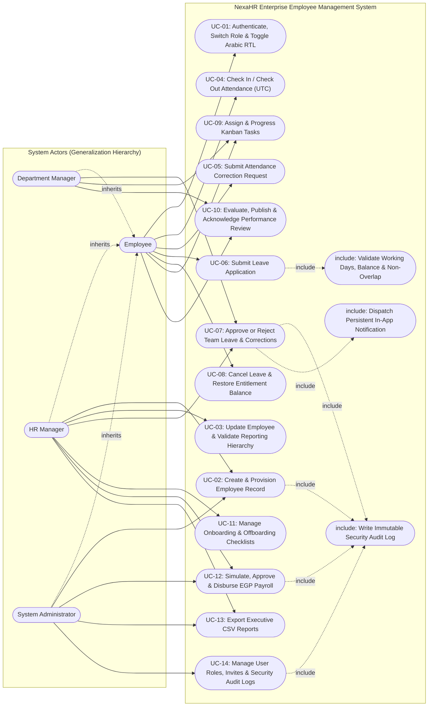

> **PlantUML Source:** [`docs/uml/use-case.puml`](docs/uml/use-case.puml)

---

### 4.2 Activity Diagram — Leave Request & Balance Transition Workflow

Models the end-to-end activity flow in `POST /api/leave/requests` and `PATCH /api/leave/requests/:id/decision`, including `Friday,Saturday` weekend exclusion, Egyptian public holiday exclusion, date-range overlap detection, `pending_days` reservation, and manager approval/rejection.

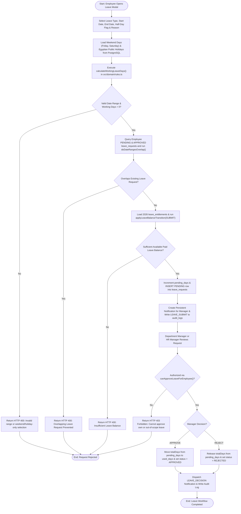

> **PlantUML Source:** [`docs/uml/leave-activity.puml`](docs/uml/leave-activity.puml)

---

### 4.3 Activity Diagram — Attendance Check-In, Check-Out & Correction Workflow

Models the server-authoritative UTC attendance state machine in `POST /api/attendance/check-in`, `POST /api/attendance/check-out`, and `PATCH /api/attendance/corrections/:id`.

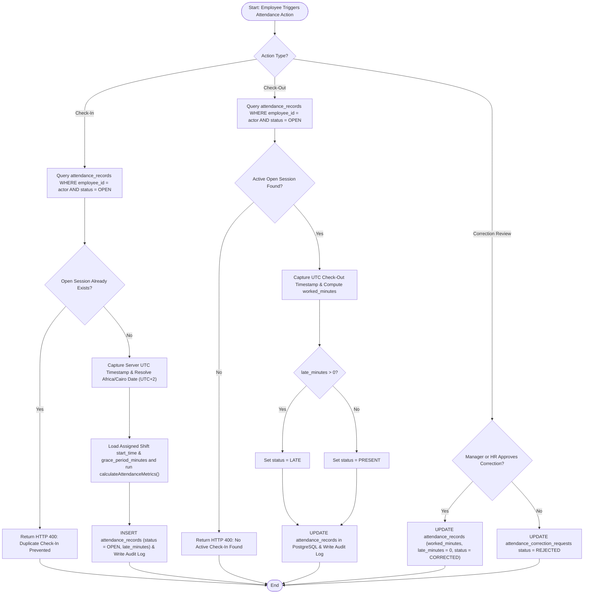

> **PlantUML Source:** [`docs/uml/attendance-activity.puml`](docs/uml/attendance-activity.puml)

---

### 4.4 Activity Diagram — Employee Creation & Automated Onboarding Provisioning

Models the multi-step transactional provisioning executed when an HR Manager or System Administrator creates a new employee in `POST /api/employees`.

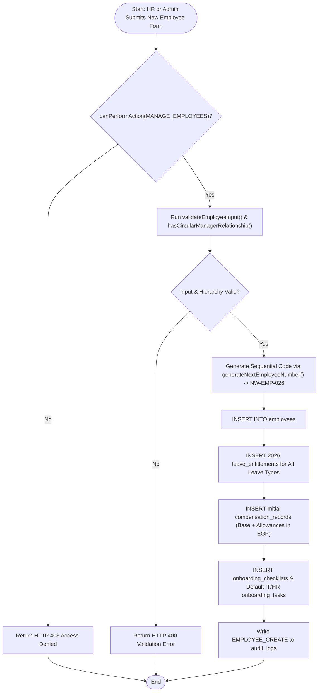

---

### 4.5 Sequence Diagram — Leave Application Submission & Manager Approval

Traces the exact method calls across the React UI (`LeavePage.tsx`), Express API (`server.ts`), Pure Domain Engine (`src/domain/rules.ts`), and Cloud SQL PostgreSQL (`src/db/schema.ts`).

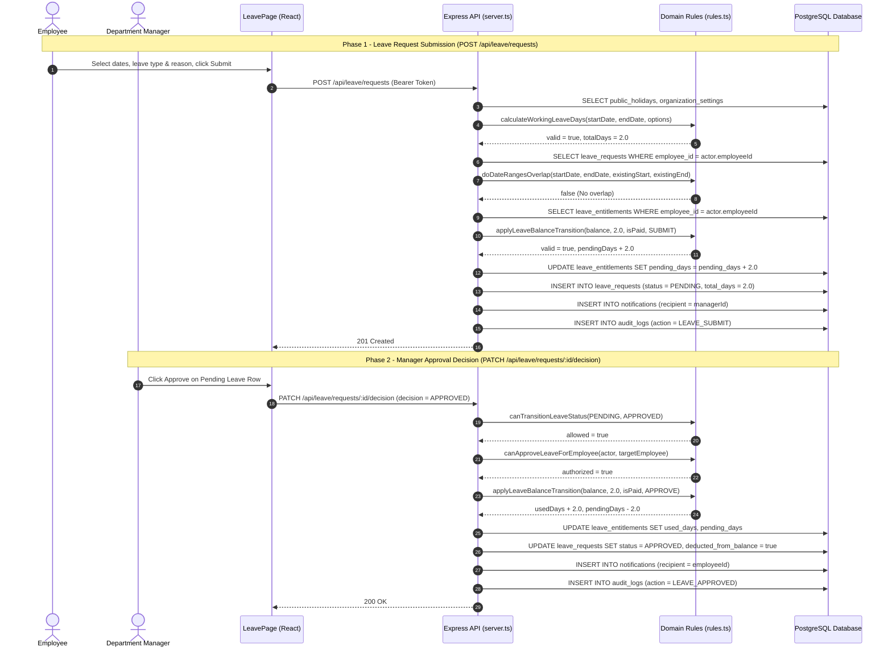

> **PlantUML Source:** [`docs/uml/leave-sequence.puml`](docs/uml/leave-sequence.puml)

---

### 4.6 Sequence Diagram — Employee Creation & Multi-Table Auto-Provisioning

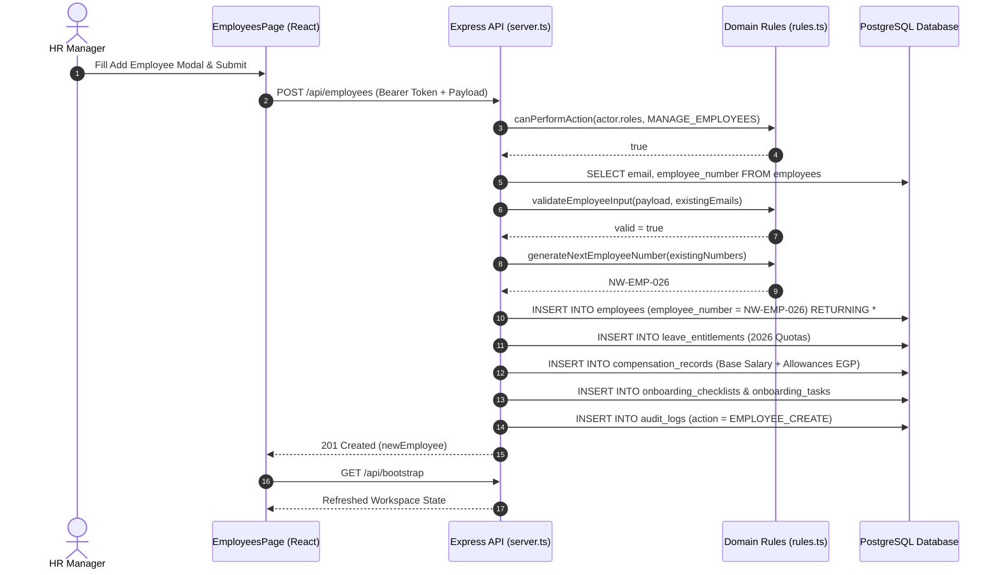

> **PlantUML Source:** [`docs/uml/employee-sequence.puml`](docs/uml/employee-sequence.puml)

---

### 4.7 Sequence Diagram — Authentication, RBAC Bootstrap & Arabic RTL Localization

Illustrates how authentication, role-scoped data filtering (`/api/bootstrap`), and bilingual Egyptian Arabic (`ar-EG`) Right-to-Left (`dir="rtl"`) switching interact.

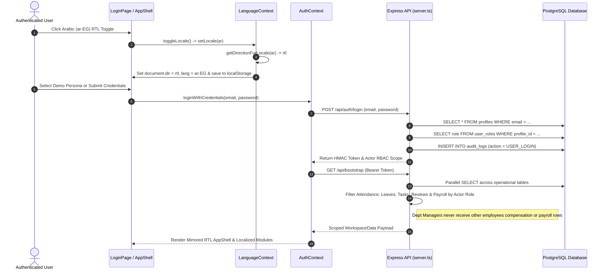

---

### 4.8 Sequence Diagram — Payroll Simulation, Compensation Confidentiality & Disbursement

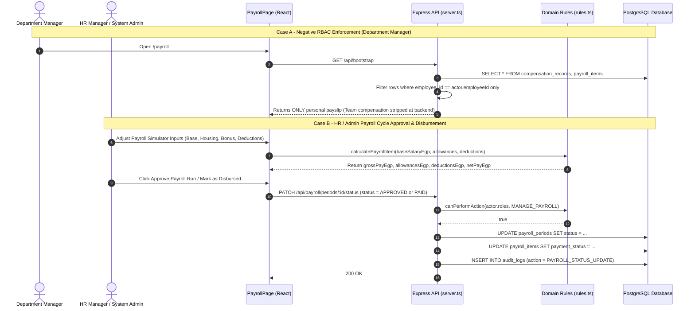

---

### 4.9 Domain Class Diagram

Models the core domain entities, attributes, multiplicities, and pure domain services (`DomainRulesService` and `LocalizationService`).

```mermaid
classDiagram
    class Profile {
        +number id
        +string uid
        +string email
        +string fullName
        +string accountStatus
        +string inviteToken
        +Date lastLoginAt
    }

    class UserRole {
        +number id
        +number profileId
        +RoleType role
    }

    class Department {
        +number id
        +string code
        +string name
        +string description
        +number managerEmployeeId
        +number budgetEgp
        +boolean isArchived
    }

    class JobTitle {
        +number id
        +string code
        +string title
        +number departmentId
        +string level
        +number minSalaryEgp
        +number maxSalaryEgp
    }

    class Employee {
        +number id
        +string employeeNumber
        +number profileId
        +string firstName
        +string lastName
        +string email
        +string phone
        +number departmentId
        +number jobTitleId
        +number managerId
        +string employmentType
        +string employmentStatus
        +string hireDate
        +number onboardingProgress
    }

    class WorkShift {
        +number id
        +string code
        +string name
        +string startTime
        +string endTime
        +number gracePeriodMinutes
        +boolean isOvernight
    }

    class AttendanceRecord {
        +number id
        +number employeeId
        +number shiftId
        +string attendanceDate
        +Date checkInUtc
        +Date checkOutUtc
        +number workedMinutes
        +number lateMinutes
        +AttendanceStatus status
    }

    class LeaveType {
        +number id
        +string code
        +string name
        +number defaultDaysPerYear
        +boolean isPaid
    }

    class LeaveEntitlement {
        +number id
        +number employeeId
        +number leaveTypeId
        +number year
        +number allocatedDays
        +number usedDays
        +number pendingDays
    }

    class LeaveRequest {
        +number id
        +number employeeId
        +number leaveTypeId
        +string startDate
        +string endDate
        +boolean isHalfDay
        +number totalDays
        +LeaveStatus status
        +number reviewedByEmployeeId
    }

    class Task {
        +number id
        +string title
        +string description
        +number assigneeEmployeeId
        +number creatorEmployeeId
        +number departmentId
        +string priority
        +TaskStatus status
        +number progressPercent
        +string dueDate
    }

    class PerformanceGoal {
        +number id
        +number employeeId
        +string title
        +string kpiMetric
        +number targetValue
        +number currentValue
        +number weightPercent
    }

    class PerformanceReview {
        +number id
        +number employeeId
        +number reviewerEmployeeId
        +string reviewCycle
        +number overallRating
        +ReviewStatus status
    }

    class OnboardingChecklist {
        +number id
        +number employeeId
        +string checklistType
        +string status
        +string targetCompletionDate
    }

    class CompensationRecord {
        +number id
        +number employeeId
        +number baseSalaryEgp
        +number housingAllowanceEgp
        +number transportAllowanceEgp
        +number standardDeductionEgp
        +boolean isCurrent
    }

    class PayrollPeriod {
        +number id
        +string periodCode
        +string status
        +number totalGrossEgp
        +number totalNetEgp
    }

    class PayrollItem {
        +number id
        +number payrollPeriodId
        +number employeeId
        +number grossPayEgp
        +number netPayEgp
        +string paymentStatus
        +string payslipRef
    }

    class DomainRulesService {
        <<service>>
        +validateEmployeeInput()
        +hasCircularManagerRelationship()
        +generateNextEmployeeNumber()
        +calculateWorkingLeaveDays()
        +doDateRangesOverlap()
        +canTransitionLeaveStatus()
        +applyLeaveBalanceTransition()
        +calculateAttendanceMetrics()
        +calculatePayrollItem()
        +canPerformAction()
        +canAccessEmployeeCompensation()
        +canApproveLeaveForEmployee()
    }

    class LocalizationService {
        <<service>>
        +getDirectionForLocale(locale)
        +translateDepartmentName(name, locale)
        +translateJobTitle(title, locale)
        +translateStatus(status, locale)
        +translateRole(role, locale)
        +translateLeaveType(name, locale)
    }

    Profile "1" --> "1..*" UserRole : assigned
    Profile "0..1" --> "0..1" Employee : activates
    Department "1" --> "0..*" Employee : employs
    Department "1" --> "1..*" JobTitle : defines
    Employee "0..1" --> "0..*" Employee : manages
    WorkShift "1" --> "0..*" AttendanceRecord : governs
    Employee "1" --> "0..*" AttendanceRecord : logs
    LeaveType "1" --> "0..*" LeaveEntitlement : configures
    Employee "1" --> "0..*" LeaveEntitlement : holds
    Employee "1" --> "0..*" LeaveRequest : submits
    Employee "1" --> "0..*" Task : assigned
    Employee "1" --> "0..*" PerformanceGoal : pursues
    Employee "1" --> "0..*" PerformanceReview : evaluatedIn
    Employee "1" --> "0..*" OnboardingChecklist : undergoes
    Employee "1" --> "1..*" CompensationRecord : receives
    PayrollPeriod "1" --> "1..*" PayrollItem : contains
    Employee "1" --> "0..*" PayrollItem : paidVia
```

> **PlantUML Source:** [`docs/uml/class-diagram.puml`](docs/uml/class-diagram.puml)

---

### 4.10 Entity-Relationship (ER) Diagram

Models the normalized PostgreSQL database schema defined in `src/db/schema.ts`.

```mermaid
erDiagram
    PROFILES ||--o{ USER_ROLES : "has_roles"
    PROFILES ||--o| EMPLOYEES : "activates"
    PROFILES ||--o{ AUDIT_LOGS : "triggers"
    DEPARTMENTS ||--o{ JOB_TITLES : "contains"
    DEPARTMENTS ||--o{ EMPLOYEES : "assigns"
    DEPARTMENTS ||--o{ TASKS : "scopes"
    JOB_TITLES ||--o{ EMPLOYEES : "classifies"
    EMPLOYEES ||--o{ EMPLOYEES : "manages"
    WORK_SHIFTS ||--o{ SHIFT_ASSIGNMENTS : "schedules"
    EMPLOYEES ||--o{ SHIFT_ASSIGNMENTS : "rostered_in"
    EMPLOYEES ||--o{ ATTENDANCE_RECORDS : "logs"
    ATTENDANCE_RECORDS ||--o{ ATTENDANCE_CORRECTION_REQUESTS : "adjusted_by"
    LEAVE_TYPES ||--o{ LEAVE_ENTITLEMENTS : "defines"
    LEAVE_TYPES ||--o{ LEAVE_REQUESTS : "categorizes"
    EMPLOYEES ||--o{ LEAVE_ENTITLEMENTS : "holds"
    EMPLOYEES ||--o{ LEAVE_REQUESTS : "submits"
    EMPLOYEES ||--o{ TASKS : "assigned_to"
    TASKS ||--o{ TASK_COMMENTS : "discusses"
    EMPLOYEES ||--o{ PERFORMANCE_GOALS : "pursues"
    EMPLOYEES ||--o{ PERFORMANCE_REVIEWS : "evaluated_in"
    EMPLOYEES ||--o{ ONBOARDING_CHECKLISTS : "undergoes"
    ONBOARDING_CHECKLISTS ||--o{ ONBOARDING_TASKS : "comprises"
    EMPLOYEES ||--o{ EMPLOYEE_DOCUMENTS : "owns"
    EMPLOYEES ||--o{ COMPENSATION_RECORDS : "receives"
    PAYROLL_PERIODS ||--o{ PAYROLL_ITEMS : "generates"
    EMPLOYEES ||--o{ PAYROLL_ITEMS : "paid_via"
    EMPLOYEES ||--o{ NOTIFICATIONS : "notified_by"

    PROFILES {
        serial id PK
        text uid UK
        text email UK
        text full_name
        text account_status
        text invite_token
    }
    USER_ROLES {
        serial id PK
        integer profile_id FK
        text role
    }
    DEPARTMENTS {
        serial id PK
        text code UK
        text name UK
        integer manager_employee_id
        numeric budget_egp
        boolean is_archived
    }
    JOB_TITLES {
        serial id PK
        text code UK
        text title UK
        integer department_id FK
        numeric min_salary_egp
        numeric max_salary_egp
    }
    EMPLOYEES {
        serial id PK
        text employee_number UK
        integer profile_id FK
        text first_name
        text last_name
        text email UK
        integer department_id FK
        integer job_title_id FK
        integer manager_id FK
        text employment_status
        text hire_date
        integer onboarding_progress
    }
    ATTENDANCE_RECORDS {
        serial id PK
        integer employee_id FK
        text attendance_date
        timestamp check_in_utc
        timestamp check_out_utc
        integer worked_minutes
        integer late_minutes
        text status
    }
    LEAVE_ENTITLEMENTS {
        serial id PK
        integer employee_id FK
        integer leave_type_id FK
        integer year
        numeric allocated_days
        numeric used_days
        numeric pending_days
    }
    LEAVE_REQUESTS {
        serial id PK
        integer employee_id FK
        integer leave_type_id FK
        text start_date
        text end_date
        numeric total_days
        text status
        boolean deducted_from_balance
    }
    TASKS {
        serial id PK
        text title
        integer assignee_employee_id FK
        integer creator_employee_id FK
        integer department_id FK
        text priority
        text status
        integer progress_percent
    }
    PERFORMANCE_REVIEWS {
        serial id PK
        integer employee_id FK
        integer reviewer_employee_id FK
        text review_cycle
        numeric overall_rating
        text status
    }
    COMPENSATION_RECORDS {
        serial id PK
        integer employee_id FK
        numeric base_salary_egp
        numeric housing_allowance_egp
        numeric transport_allowance_egp
        numeric standard_deduction_egp
        boolean is_current
    }
    PAYROLL_PERIODS {
        serial id PK
        text period_code UK
        text status
        numeric total_gross_egp
        numeric total_net_egp
    }
    PAYROLL_ITEMS {
        serial id PK
        integer payroll_period_id FK
        integer employee_id FK
        numeric gross_pay_egp
        numeric net_pay_egp
        text payment_status
        text payslip_ref
    }
```

> **Mermaid Source:** [`docs/uml/entity-relationship.mmd`](docs/uml/entity-relationship.mmd)

---

### 4.11 State Machine Diagrams (Leave, Tasks, Performance Reviews & Payroll)

#### A. Leave Request & Entitlement Balance State Machine (`canTransitionLeaveStatus`)

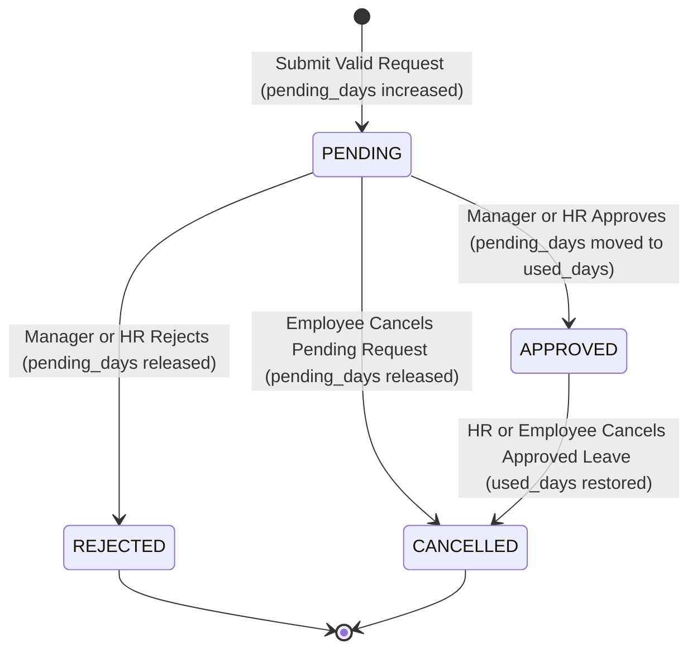

#### B. Task Kanban Lifecycle State Machine

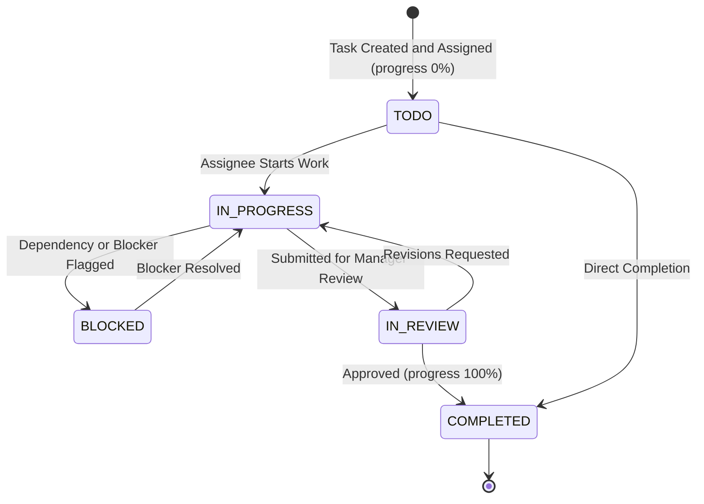

#### C. Performance Review Appraisal State Machine

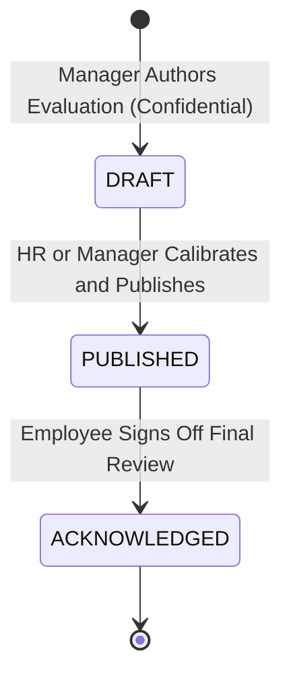

#### D. Payroll Period Governance State Machine

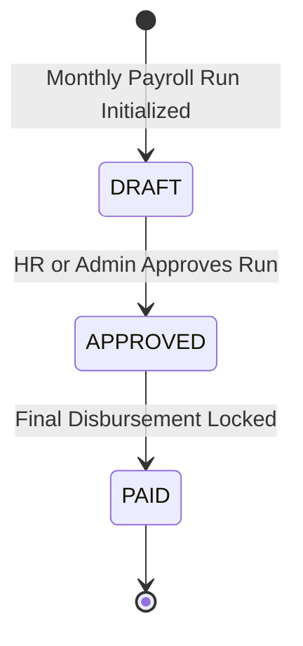

> **PlantUML Source:** [`docs/uml/leave-state-machine.puml`](docs/uml/leave-state-machine.puml)

---

### 4.12 Component & 5-Layer Architecture Diagram

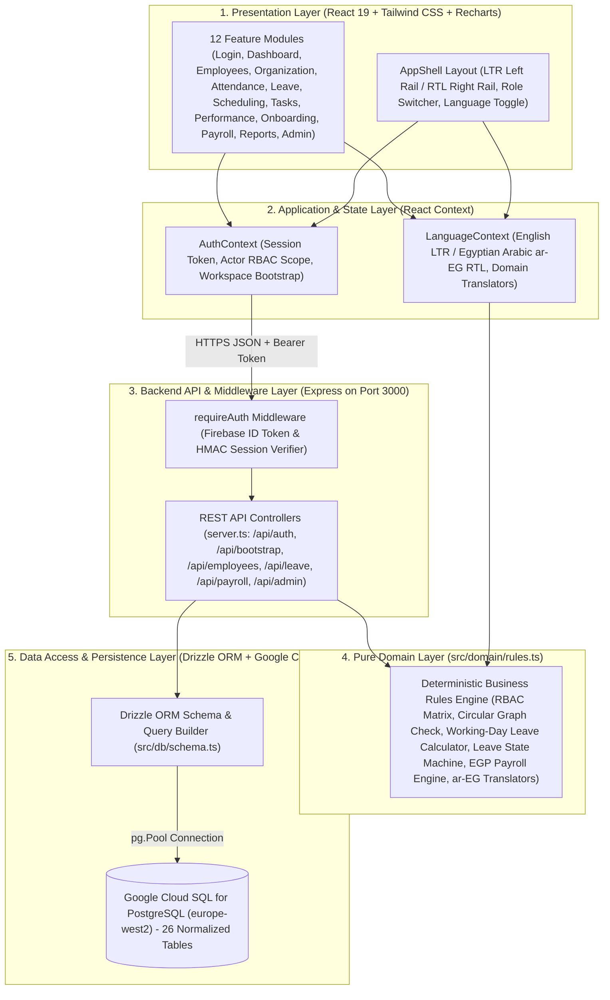

> **Mermaid Source:** [`docs/uml/component-architecture.mmd`](docs/uml/component-architecture.mmd)

---

### 4.13 Deployment & Infrastructure Diagram

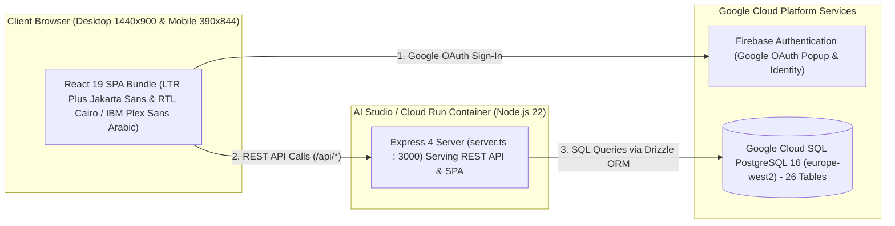

---

## 5. Requirements-to-Code & Database Traceability Matrix

| Req ID | Requirement Summary | Frontend Component | Backend Endpoint (`server.ts`) | Domain Rule (`src/domain/rules.ts`) | PostgreSQL Tables (`src/db/schema.ts`) |
| :--- | :--- | :--- | :--- | :--- | :--- |
| **FR-001** | Authentication, Password Reset & Invite Activation | `LoginPage.tsx` | `POST /api/auth/login`, `/reset-password`, `/accept-invite` | `canPerformAction` | `profiles`, `user_roles`, `audit_logs` |
| **FR-002** | 4-Role RBAC & Server-Side Scope Filtering | `AppShell.tsx`, `AuthContext.tsx` | `GET /api/bootstrap` | `canPerformAction`, `canAccessEmployeeCompensation` | `user_roles`, `profiles`, `employees` |
| **FR-003** | Employee CRUD, Auto `NW-EMP-XXX` & Archival | `EmployeesPage.tsx` | `POST /api/employees`, `PUT /api/employees/:id`, `PATCH /:id/archive` | `validateEmployeeInput`, `generateNextEmployeeNumber`, `hasCircularManagerRelationship` | `employees`, `employee_documents` |
| **FR-004** | Department CRUD, Archival Guard & Org Chart | `OrganizationPage.tsx` | `POST /api/departments`, `PUT /api/departments/:id`, `POST /api/job-titles` | `canPerformAction('MANAGE_DEPARTMENTS')` | `departments`, `job_titles` |
| **FR-005** | UTC Check-In/Out, Duplicate Guard & Corrections | `AttendancePage.tsx` | `POST /api/attendance/check-in`, `/check-out`, `/corrections` | `calculateAttendanceMetrics` | `attendance_records`, `attendance_correction_requests` |
| **FR-006** | Leave Working-Day Calculator & Overlap Guard | `LeavePage.tsx` | `POST /api/leave/requests`, `PATCH /api/leave/requests/:id/decision` | `calculateWorkingLeaveDays`, `doDateRangesOverlap`, `canTransitionLeaveStatus`, `applyLeaveBalanceTransition` | `leave_types`, `leave_entitlements`, `leave_requests`, `public_holidays` |
| **FR-007** | Shift Definitions & Employee Roster Assignment | `SchedulingPage.tsx` | `POST /api/shifts`, `POST /api/shifts/assign` | `calculateAttendanceMetrics` | `work_shifts`, `shift_assignments`, `public_holidays` |
| **FR-008** | Kanban Task Board, Progress & Comments | `TasksPage.tsx` | `POST /api/tasks`, `PATCH /api/tasks/:id`, `POST /api/tasks/:id/comments` | `canPerformAction('MANAGE_TEAM_TASKS')` | `tasks`, `task_comments` |
| **FR-009** | Weighted Performance Appraisal & OKR Goals | `PerformancePage.tsx` | `POST /api/performance/goals`, `PATCH /api/performance/reviews/:id` | `canPerformAction('MANAGE_PERFORMANCE_REVIEWS')` | `performance_goals`, `performance_reviews` |
| **FR-010** | Automated Onboarding & Offboarding Checklists | `OnboardingPage.tsx` | `POST /api/onboarding/checklists`, `PATCH /api/onboarding/tasks/:id/toggle` | `canPerformAction('MANAGE_ONBOARDING')` | `onboarding_checklists`, `onboarding_tasks` |
| **FR-011** | EGP Payroll Engine & Compensation Privacy | `PayrollPage.tsx` | `POST /api/payroll/compensation`, `PATCH /api/payroll/periods/:id/status` | `calculatePayrollItem`, `canAccessEmployeeCompensation` | `compensation_records`, `payroll_periods`, `payroll_items` |
| **FR-012** | Executive Analytics & CSV Data Exports | `ReportsPage.tsx`, `DashboardPage.tsx` | `GET /api/bootstrap` | `formatDateDDMMYYYY` | All operational tables |
| **FR-013** | Immutable Security Audit Logs & Role Admin | `AdminPage.tsx` | `PATCH /api/admin/users/:profileId/role`, `PUT /api/admin/settings` | `canPerformAction('MANAGE_USERS_AND_ROLES')` | `audit_logs`, `organization_settings`, `user_roles` |
| **FR-014** | Egyptian Arabic (`ar-EG`) RTL Localization | `LanguageContext.tsx`, All 12 Pages | Bilingual client-side + domain translation layer | `getDirectionForLocale`, `translateDepartmentName`, `translateJobTitle`, `translateStatus`, `translateRole`, `translateLeaveType` | Preserves canonical English/ISO database storage while rendering full Arabic RTL UI |

---

## 6. Documentation Index (`/docs`)

In addition to this `README.md`, detailed Software Engineering II documents are organized in `/docs`:

- **Requirements & Use Cases:**
  - [`docs/requirements/SRS.md`](docs/requirements/SRS.md) — Software Requirements Specification (`FR` & `NFR` catalog)
  - [`docs/requirements/USE_CASES.md`](docs/requirements/USE_CASES.md) — 12 Structured Use Case Specifications (Preconditions, Postconditions, Main & Exception Flows)
  - [`docs/requirements/TRACEABILITY_MATRIX.md`](docs/requirements/TRACEABILITY_MATRIX.md) — Full Traceability Matrix
- **Architecture, Schema & Verification:**
  - [`docs/architecture/ARCHITECTURE.md`](docs/architecture/ARCHITECTURE.md) — 5-Layer Architecture & RBAC Security Model
  - [`docs/database/SCHEMA.md`](docs/database/SCHEMA.md) — 26-Table Normalized PostgreSQL Schema Documentation
  - [`docs/TEST_PLAN.md`](docs/TEST_PLAN.md) — Automated Unit Test & Negative RBAC Verification Plan
- **Standalone UML Diagram Source Files (`docs/uml/`):**
  - [`docs/uml/use-case.puml`](docs/uml/use-case.puml)
  - [`docs/uml/leave-activity.puml`](docs/uml/leave-activity.puml)
  - [`docs/uml/attendance-activity.puml`](docs/uml/attendance-activity.puml)
  - [`docs/uml/leave-sequence.puml`](docs/uml/leave-sequence.puml)
  - [`docs/uml/employee-sequence.puml`](docs/uml/employee-sequence.puml)
  - [`docs/uml/class-diagram.puml`](docs/uml/class-diagram.puml)
  - [`docs/uml/leave-state-machine.puml`](docs/uml/leave-state-machine.puml)
  - [`docs/uml/entity-relationship.mmd`](docs/uml/entity-relationship.mmd)
  - [`docs/uml/component-architecture.mmd`](docs/uml/component-architecture.mmd)

---

## 7. Running & Testing Locally

```bash
# 1. Install dependencies
npm install

# 2. Run pure domain unit tests (10 test suites including RBAC, Leave State Machine, Payroll & Arabic RTL)
node --test src/domain/rules.test.ts

# 3. Type-check and build production bundle
npm run lint
npm run build

# 4. Start full-stack Express + Vite server on http://localhost:3000
npm run dev
```
